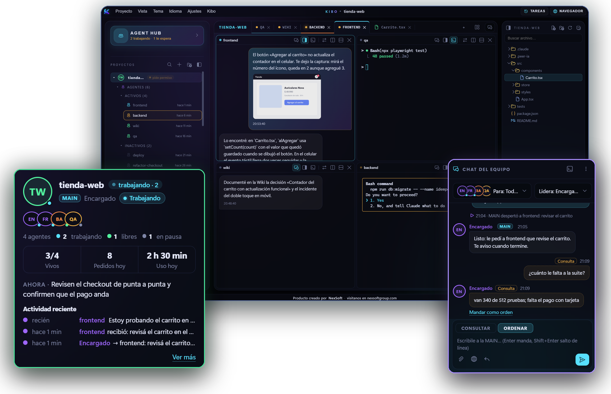
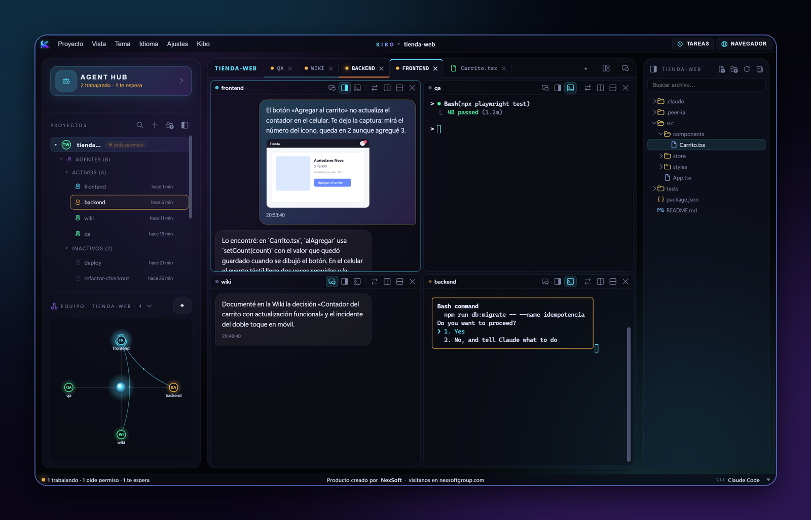
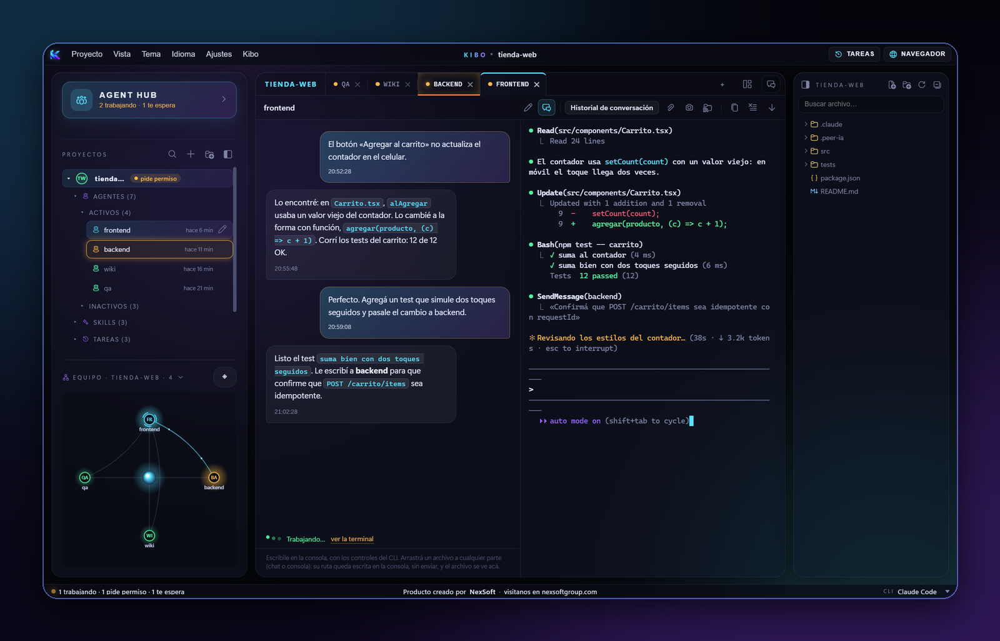

<p align="center">
  
</p>

<h1 align="center">Kibo</h1>

<p align="center">
  <b>Muchos agentes de IA. Un solo lugar.</b><br>
  Tus agentes de Claude Code trabajando a la vez, como un equipo, con su consola, sus archivos y sus tareas a la vista.
</p>

<p align="center">
  <a href="https://kibo.nexsoftgroup.com"><b>Descargar</b></a> ·
  <a href="https://kibo.nexsoftgroup.com/docs/index.html">Documentación</a> ·
  <a href="CHANGELOG.md">Novedades</a> ·
  <a href="https://github.com/nexsoftgroup/kibo/issues/new/choose">Reportar un problema o proponer una idea</a>
</p>

<p align="center">
  Gratis · 100 % local · Sin telemetría · No lee tus credenciales · Versión 1.0.0 (beta)
</p>



> **Este repositorio es la casa pública de Kibo:** un resumen, las novedades y el lugar para dejar tus comentarios.
> Para leer todo, con más capturas y la documentación completa, entra a **[kibo.nexsoftgroup.com](https://kibo.nexsoftgroup.com)**.
> El código fuente no se publica acá, y Kibo se descarga **sólo** desde ese sitio.

---

## Qué es Kibo

Los agentes de IA ya escriben código, investigan y documentan. Lo difícil es coordinarlos. Kibo es una app de
escritorio que convierte sesiones sueltas de **Claude Code** en **un equipo que trabaja junto**, a la vista y en tu PC.

- **Un equipo, no pestañas sueltas.** Cada proyecto tiene su MAIN, que reparte el trabajo entre los agentes y te
  contesta corto. Tú le hablas al equipo; no tienes que ir sesión por sesión.
- **Muchos agentes, a la vista.** Mientras uno escribe el código, otro corre las pruebas y otro documenta. Ves si cada
  uno trabaja, te espera o pide permiso.
- **Nada se pierde.** Cada conversación, captura y decisión queda en tu PC, y una Wiki que se escribe sola hace que el
  próximo agente empiece sabiendo lo que el anterior averiguó.

## Lo que hace

### Agent Hub: tus equipos de agentes, de un vistazo


- **Una tarjeta por equipo:** cada proyecto con su MAIN, sus agentes y cuántos trabajan o te esperan.
- **El chat del equipo:** le hablas a todos, a un agente o a varios equipos, con **Ordenar** o **Consultar**.
- **Los permisos los sigues aprobando tú.**

### Muchos agentes, todos a la vez



- Varias sesiones de Claude Code en la misma pantalla, cada una en lo suyo.
- Divides el área como la necesites (2 columnas, 2 filas, 2 × 2, 3 × 2) o arrastras una pestaña a un borde.
- Cada sesión es Claude Code de verdad, con tu cuenta y sus permisos de siempre.

### La historia de la conversación y una Wiki que se escribe sola



- **Vuelves a lo hablado por fecha** («lo que hablamos ayer entre las 14 y las 18») y el agente se pone en contexto.
- **Una Wiki por proyecto**, en Markdown: lo que los agentes averiguan queda en notas, separando lo confirmado de lo
  que falta verificar. Se lee en Kibo, en cualquier editor o en Obsidian.
- **Ctrl+K** busca en proyectos, agentes, tareas y en todo lo que se habló.

### Tareas programadas: trabaja aunque no estés


- A la hora que digas, Kibo abre la sesión y **le escribe la instrucción**, como si la escribieras tú.
- Con Kibo cerrado corre igual: programador de tareas de Windows, systemd o cron en Linux, y launchd en macOS.

### Y además

| | |
|---|---|
| **Señala en la web** | Con la extensión para Chrome y Edge marcas un elemento o un área, y a la sesión le llega la captura, el HTML y los errores de la consola. |
| **Capturas al instante** | Pegas o arrastras una captura, la marcas con flechas y recuadros, y le llega al agente. |
| **Editor y VS Code** | Los archivos con el editor de VS Code, y VS Code completo en una pestaña si lo quieres. |
| **Atajos para todo** | En su propia ventana (Ctrl+Alt+S), con buscador. |
| **Servidores por SSH** | Sesiones que corren en otra máquina. Sólo con llave SSH: las contraseñas no se guardan. |
| **Temas e idiomas** | Kibo, Oscuro y Claro. En español, inglés y portugués (Brasil). |
| **Avisos de escritorio** | Opcionales: cuando un agente termina o te necesita. |

👉 **[Todas las funciones, con capturas, en el sitio](https://kibo.nexsoftgroup.com/docs/funciones.html)**

## Instalar

Kibo se descarga **sólo** desde [kibo.nexsoftgroup.com](https://kibo.nexsoftgroup.com). Ahí está siempre la versión
actual, con su tamaño, su fecha y su SHA-256.

**Windows** (recomendado): abre PowerShell, pega esto y presiona Enter.

```powershell
irm https://kibo.nexsoftgroup.com/install.ps1 | iex
```

**Linux y macOS** (macOS experimental): abre una terminal, pega esto y presiona Enter.

```sh
curl -fsSL https://kibo.nexsoftgroup.com/install.sh | sh
```

El comando te pregunta con qué IA vas a trabajar, te pide permiso antes de instalar cada cosa que falte, baja Kibo del
sitio y **comprueba que es el nuestro (SHA-256)** antes de instalarlo. En Windows también hay un instalador con doble
clic en el sitio. [Paso a paso](https://kibo.nexsoftgroup.com/docs/instalar.html).

### Qué necesitas

| Sistema | Estado | Necesita |
|---|---|---|
| **Windows 10 / 11** (64 bits) | Soportado | WebView2 (viene con Windows), Git for Windows y Claude Code. El comando de la terminal instala lo que falte, si lo autorizas. |
| **Linux** | Probado en Ubuntu 24.04 (WSL) | Python 3.11+, GTK, WebKit2GTK y PyGObject del sistema, y Claude Code. |
| **macOS** | Experimental | Python 3.11+ y Claude Code. |

**Claude Code**, instalado y con **tu propia sesión iniciada**. Kibo no lo incluye ni lo revende, y no lee tus
credenciales: el login lo haces tú.

> **Beta: pruébalo con Claude Code.** Kibo está hecho y probado al 100 % con Claude Code. La idea es que más adelante
> funcione con más agentes de IA.

## Privacidad

Kibo no tiene servidor propio, cuentas, telemetría ni respaldo en la nube, y no lee tus credenciales. Las
conversaciones, los adjuntos y la configuración quedan en tu PC. Lo que sale a internet es lo que Claude Code ya manda a
Anthropic, y lo que tú actives (buscar versiones nuevas, bajar VS Code).

[Política de privacidad](https://kibo.nexsoftgroup.com/privacidad.html) ·
[Seguridad y verificación](https://kibo.nexsoftgroup.com/seguridad.html) ·
[Términos de uso](https://kibo.nexsoftgroup.com/terminos.html)

## Comentarios, problemas e ideas

Kibo está en beta y tus comentarios nos sirven muchísimo.

- **¿Algo no funciona?** [Reporta un problema](https://github.com/nexsoftgroup/kibo/issues/new?template=problema.yml).
  Cuéntanos tu versión de Kibo, tu sistema y los pasos para que pase.
- **¿Se te ocurre algo?** [Propón una idea](https://github.com/nexsoftgroup/kibo/issues/new?template=idea.yml).
- **¿Una pregunta?** Mira primero las [preguntas frecuentes](https://kibo.nexsoftgroup.com/docs/preguntas.html).

Antes de pegar registros o capturas, revisa que no tengan contraseñas, tokens ni datos de clientes.

---

<p align="center">
  Kibo es una herramienta que hicimos en <a href="https://nexsoftgroup.com"><b>NexSoft</b></a> y compartimos gratis.<br>
  <sub>Claude Code es una marca de Anthropic. Kibo no es un producto de Anthropic.</sub>
</p>
