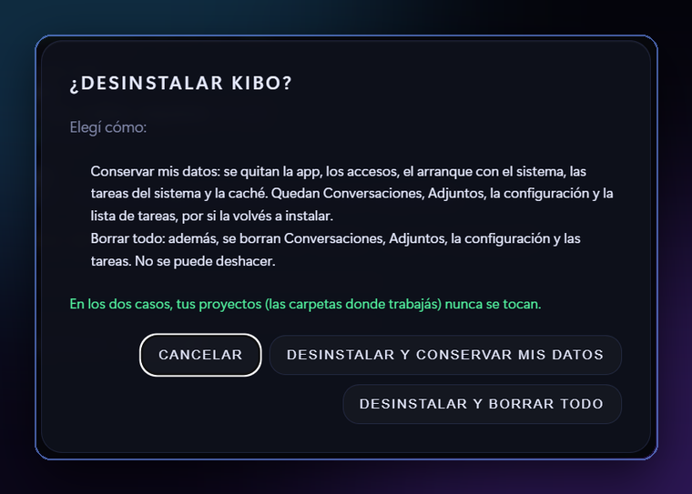

# Desinstalar Kibo

En cualquier caso, **tus proyectos (las carpetas donde trabajas) no se tocan nunca**.

## Desde Kibo

Menú **Kibo → Desinstalar Kibo…**



## Desde Windows

**Configuración → Aplicaciones → Kibo → Desinstalar**. Vale para el instalador y para el comando de la terminal. Cierra Kibo, quita sus tareas programadas y te pregunta si borrar también tus datos (conversaciones, adjuntos, configuración y tareas, en `%LOCALAPPDATA%\Kibo`). Si dices que no, quedan guardados y una instalación nueva los vuelve a usar.

## Linux y macOS, desde una consola

```
bash ~/Kibo/kibo/uninstall.sh
```

Te pregunta:

- **Conservar mis datos:** se quitan la app, el comando `kibo`, el acceso del menú, el arranque con el sistema, las tareas y la caché. Quedan las conversaciones, los adjuntos, la configuración y la lista de tareas, por si lo vuelves a instalar.
- **Borrar todo:** además, borra esos datos. Hay que escribir `BORRAR` para confirmar.

Para no preguntar: `uninstall.sh --conservar` o `--borrar-todo`.

Lo que Claude Code guarda por su cuenta (en `~/.claude`) es suyo: Kibo no lo borra.

---

[← Actualizar](actualizar.md)[Preguntas frecuentes →](preguntas.md)
