# Todo lo que hace Kibo

La guía completa, función por función. Si recién empiezas, mira antes [Primeros pasos](primeros-pasos.md).

**En esta página**

[Agent Hub: tus equipos de agentes](#agent-hub-tus-equipos-de-agentes) · [Proyectos y sesiones](#proyectos-y-sesiones) · [La ventana: barra de menús, barra de estado y área de trabajo](#la-ventana-barra-de-menus-barra-de-estado-y-area-de-trabajo) · [Las pestañas](#las-pestanas) · [La consola y la conversación](#la-consola-y-la-conversacion) · [Volver a lo hablado por fecha](#volver-a-lo-hablado-por-fecha) · [Las sesiones siguen aunque cierres Kibo](#las-sesiones-siguen-aunque-cierres-kibo) · [Paneles a tu medida](#paneles-a-tu-medida) · [Agentes y el recuadro de abajo](#agentes-y-el-recuadro-de-abajo) · [Buscar en todo (Ctrl+K)](#buscar-en-todo-ctrlk) · [Ver un archivo donde está la conversación](#ver-un-archivo-donde-esta-la-conversacion) · [Comentar y «¿Para qué es esto?»](#comentar-y-para-que-es-esto) · [Consultas sin interrumpir al agente (💬)](#consultas-sin-interrumpir-al-agente) · [Divide el área de trabajo como la necesites](#divide-el-area-de-trabajo-como-la-necesites) · [VS Code completo, adentro](#vs-code-completo-adentro) · [Documentos y capturas en la conversación](#documentos-y-capturas-en-la-conversacion) · [El navegador: señalar cosas de la web](#el-navegador-senalar-cosas-de-la-web) · [Tareas programadas](#tareas-programadas) · [El equipo: tus agentes de un vistazo](#el-equipo-tus-agentes-de-un-vistazo) · [Proyectos en un servidor (VPS)](#proyectos-en-un-servidor-vps) · [Un proyecto nuevo, con su Wiki que se escribe sola](#un-proyecto-nuevo-con-su-wiki-que-se-escribe-sola) · [Personalidad: lo que Claude tiene siempre presente](#personalidad-lo-que-claude-tiene-siempre-presente) · [Avisos de escritorio](#avisos-de-escritorio) · [Atajos de teclado a tu gusto](#atajos-de-teclado-a-tu-gusto) · [Menús, idioma y tema](#menus-idioma-y-tema) · [Atajos](#atajos)

<a name="agent-hub-tus-equipos-de-agentes"></a>
## Agent Hub: tus equipos de agentes

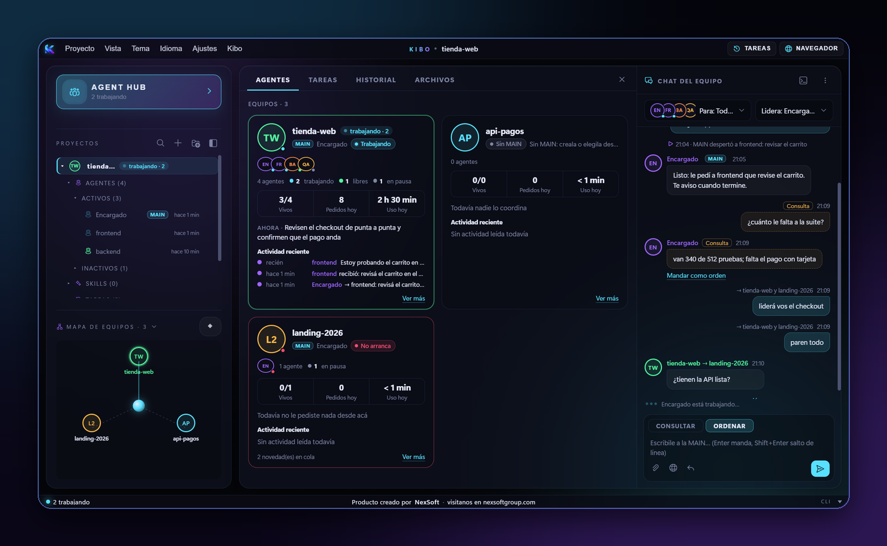

Cuando tienes varios proyectos con varios agentes cada uno, ir sesión por sesión cansa. **Agent Hub** los junta: cada proyecto es un **equipo**, con una **MAIN** (la encargada) y sus **peers** (los demás agentes del proyecto). Tú le hablas al equipo y la MAIN reparte el trabajo, junta lo que informan los peers y te contesta corto. Las sesiones siguen como siempre: Agent Hub es una capa encima. La MAIN y sus peers son sesiones de **Claude Code**.

<a name="como-se-abre"></a>
### Cómo se abre

Con la tarjeta **AGENT HUB**, la primera del panel izquierdo (arriba de **PROYECTOS**), que dice cuántos agentes trabajan y cuántos te esperan, o con **Ctrl+Shift+T**. Mientras está abierto se esconde el panel de archivos, y vuelve al salir. **✕** lo cierra; **Esc** sube un nivel y, en los equipos, lo cierra.

<a name="como-se-trabaja-con-cada-equipo"></a>
### Cómo se trabaja con cada equipo

- **Agentes:** una tarjeta por equipo, con el avatar de color del proyecto, su MAIN y su estado; los mini avatares de sus agentes (hasta 7 y «+N») y cuántos trabajan, te esperan, están libres o en pausa; los vivos, los pedidos y el uso de hoy; **Ahora** (el último pedido) y la actividad reciente.
- **Ver más** abre el **detalle del equipo**, para ver cómo le fue: un resumen; **Cómo va**, con los números de hoy (agentes, trabajando, te esperan, pedidos, uso, herramientas, archivos tocados y subagentes); **Agentes del equipo**, una fila por agente con en qué está, su último pedido, su uso de hoy, desde qué hora trabaja y su última actividad (cada fila se despliega con su actividad, lo que hizo hoy, sus subagentes y los archivos que tocó; con 8 agentes o más aparece un buscador); **Lo que pasó**, una línea de tiempo, y las tareas programadas del equipo.
- **Tareas:** las tareas programadas de todos los equipos, con filtro por equipo.
- **Historial:** lo hablado con cada equipo, por día (hoy, 7 o 30 días), con buscador.
- **Archivos:** el árbol de archivos del equipo.
- **El mapa de equipos**, abajo a la izquierda: cada círculo es un equipo y un clic abre su detalle. Cada proyecto tiene su **avatar de color**, el mismo en el panel, el mapa, las tarjetas y el chat.

Los números salen de los historiales de Claude Code de ese proyecto (sólo lectura, sólo lo de hoy); del uso de herramientas se muestra un resumen, nunca el comando ni el contenido.

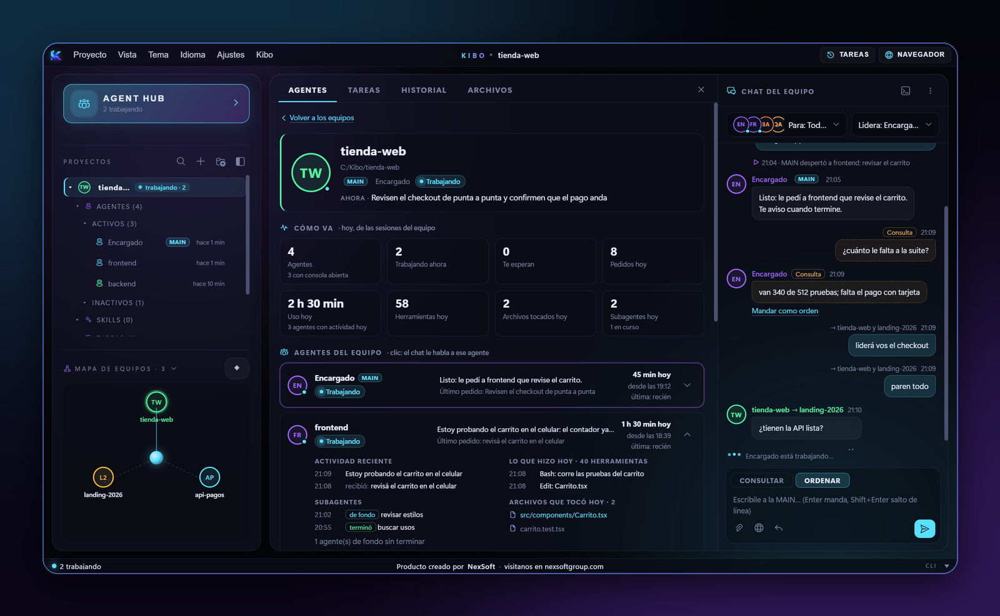

<a name="como-le-pasas-informacion"></a>
### Cómo le pasas información

Todo va por el **chat del equipo**, a la derecha:

- **Para:** a quién le hablas: **Todos** (la MAIN del equipo), **un agente** (un clic en su fila: le llega directo y, si dormía, se despierta) o **varios equipos** a la vez. Se recuerda.
- **Ordenar** manda un mensaje de verdad: entra en la conversación y la MAIN se pone a trabajar. **Consultar** es una pregunta al costado, como `/btw`, que no la interrumpe; si te gusta la respuesta, **Mandar como orden**.
- Con el mensaje van 📎 **adjuntos** (archivos, capturas), 🌐 **lo que señalaste en el navegador** y ↩ **una referencia a su última respuesta**.
- **Ctrl+V en la caja del chat:** una imagen abre el [editor de capturas](#cada-version-queda-guardada-en-su-proyecto), donde puedes sumar varias y comentar cada una antes de adjuntarlas; los archivos que copiaste en el Explorador se adjuntan directo, y el texto se pega normal. *Desde la 1.0.4.*
- **Abrir su consola** te lleva a la sesión de verdad, y el menú **…** tiene nuevo peer, despertar, renombrar y hacer MAIN.

<a name="como-se-comunican"></a>
### Cómo se comunican

- **Tú → MAIN:** tu mensaje le llega marcado «[tú desde Agent Hub]».
- **Peer → peer:** cualquier agente puede derivarle una tarea a otro del mismo proyecto con `hablar <peer> "mensaje"`, aunque esté inactivo: Kibo lo despierta con el mensaje. Con `equipo` ve quién está en el proyecto y en qué estado. No se despierta una Wiki detenida ni una sesión abierta en otra ventana. Cada sesión que abre Kibo recibe estas instrucciones al empezar, y la MAIN sabe que los peers se derivan tareas sin pasar por ella. *Desde la 1.0.4.*
- **MAIN → peers:** la MAIN no lanza procesos: le **pide a Kibo** listar, despertar, crear o escribirle a un peer, y Kibo lo hace. Kibo **comprueba que el encargo le llegó** y, si no, lo reintenta y le avisa a la MAIN.
- **Peers → MAIN:** la MAIN les pide que le informen al terminar, en pocas líneas. Además, **Kibo le avisa sola** cuando un peer termina, pide permiso o se traba (diez minutos trabajando sin novedades): agrupa los avisos que llegan juntos, espera a que la MAIN esté libre, no repite el mismo aviso y no la despierta si el peer ya le informó. Quieta, la MAIN no gasta: sólo se mueve cuando hay novedades de lo que ella encargó.
- **MAIN ↔ MAIN:** la MAIN de un proyecto le puede consultar o pedir algo a la de otro, siempre a través de Kibo. Sólo entre MAIN (los peers no cruzan de proyecto), con un tope por par para evitar bucles.
- **Varios equipos a la vez:** con **Lidera**, una MAIN lidera y las demás colaboran con ella. Cada una sabe, antes de la orden, quién lidera; las que colaboran le informan a la que lidera, y esa te contesta con el resultado de todas.
- **Todo queda a la vista:** quién despertó, creó o le escribió a qué peer, cuándo y por qué, en el chat del equipo y en **Mensajes entre agentes**.

**Lo que escribes en el chat del equipo aparece al instante**, con «enviando…», sin esperar a que la MAIN o el peer lo reciba. Si no se pudo mandar, dice «no se envió» y el texto vuelve a la caja para que lo reintentes. *Desde la 1.0.1.* El chat también muestra **quién del equipo está trabajando**, aunque no sea la MAIN. *Desde la 1.0.4.*

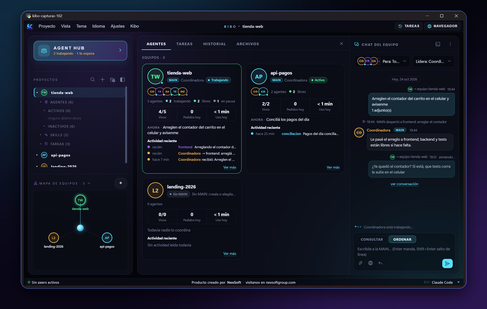

<a name="como-orquesta-la-main"></a>
### Cómo orquesta la MAIN

Orquestar es algo que hace **Claude**; lo que lo vuelve ordenado es **la configuración de Kibo**. Al empezar, Kibo le da a la MAIN su **rol**: qué proyecto tiene a cargo, qué herramientas tiene para manejar a sus peers y con qué reglas:

- **Repartir, no hacer:** no hace el trabajo pesado salvo cosas chicas; reparte entre los peers y junta lo que informan.
- **Cuidar el costo:** antes de crear un peer, mira si hay uno libre o inactivo que sirva y lo reutiliza. Cada peer vivo es una sesión de Claude que gasta de tu plan y memoria de la PC: con **5 o más vivos, te pregunta** antes de crear otro. Al empezar, si no hay nada pendiente, no despierta a nadie.
- **Contestarte corto:** de 1 a 5 líneas, qué pasó y qué falta.
- **Los permisos son tuyos:** no puede aprobar un permiso de un peer; si un peer pide permiso, te lo resume. Si un agente (o la misma MAIN) tiene un cartel abierto, Agent Hub lo marca y abres su consola: esa decisión es tuya.
- **Sólo su proyecto:** crea, despierta y le escribe sólo a peers de su carpeta, con los mismos permisos que cualquier sesión (Kibo arma los argumentos; no hay forma de saltear permisos). Para otros proyectos, sólo MAIN ↔ MAIN.
- **Órdenes firmadas:** cada orden de la MAIN lleva una firma que sólo tiene la consola de esa MAIN, así que un peer no puede hacerse pasar por ella.
- **Siempre viva:** con el proyecto abierto, Kibo la levanta y, si se cae, la relanza; si no arranca después de varios intentos, te avisa con **Reintentar**.
- **Memoria:** si le comprimieron la conversación, puede volver a lo hablado por fecha con `historial`.

**La MAIN de cada proyecto se elige** con clic derecho en una sesión del panel → **Hacer MAIN del proyecto**, o desde el menú **…** del chat; si mandas algo a un equipo sin MAIN, Kibo te ofrece crearla. Si un equipo no tiene MAIN, su tarjeta (y su detalle) muestra el botón **Sin MAIN**: abre las sesiones del proyecto para que elijas una, o **Crear una MAIN nueva**. *Desde la 1.0.4.* Lleva el chip **MAIN** en el panel, en su pestaña y en Agent Hub.

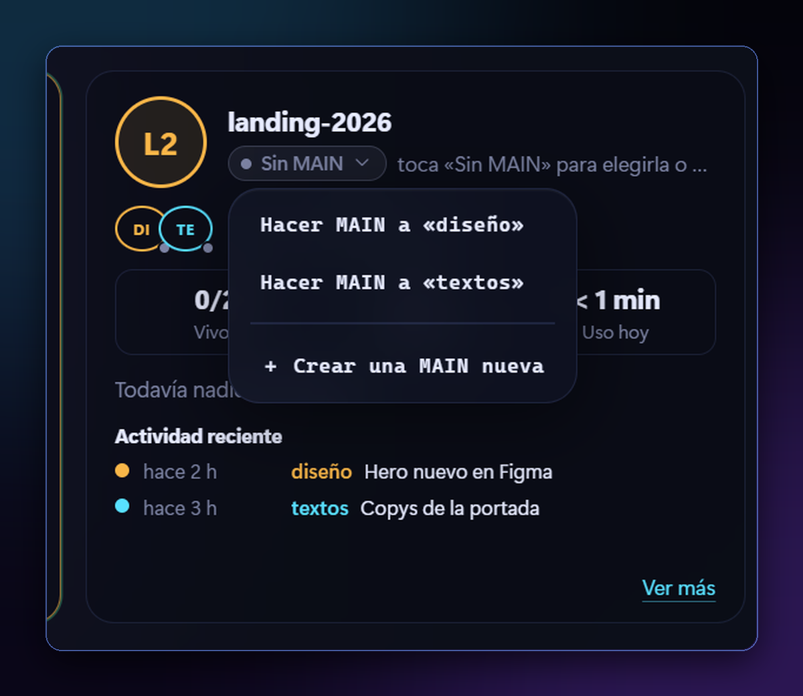

<a name="los-agentes-no-se-pisan"></a>
### Los agentes no se pisan

*Desde la 1.0.4.* Cuando varios peers trabajan en el mismo proyecto, dos podrían querer editar el mismo archivo a la vez. Kibo lo evita:

- **El segundo espera:** si un peer quiere editar un archivo que otro está editando, Kibo lo frena, le dice quién lo tiene y lo deja esperando. Cuando el primero termina su turno, Kibo le avisa al segundo que ya puede seguir.
- **Nada queda bloqueado para siempre:** un archivo se libera solo a los 15 minutos sin cambios.
- **Los peers se pueden hablar** para coordinarse, con `hablar <peer> "mensaje"`. Queda en el registro del equipo, a la vista.
- **Ceder antes:** si su trabajo no se cruza, el que tiene el archivo lo libera con `candado ceder <archivo>`. `candado lista` muestra quién tiene cada archivo.
- **La MAIN lo previene:** evita darle el mismo archivo a dos peers a la vez.

Sólo afecta a las sesiones que abre Kibo. Las sesiones de Claude que abres por tu cuenta no cambian, y Kibo no toca la configuración de ningún proyecto. Para que cada peer trabaje en su propia copia del repo, está el [worktree por peer](worktree-por-peer.md).

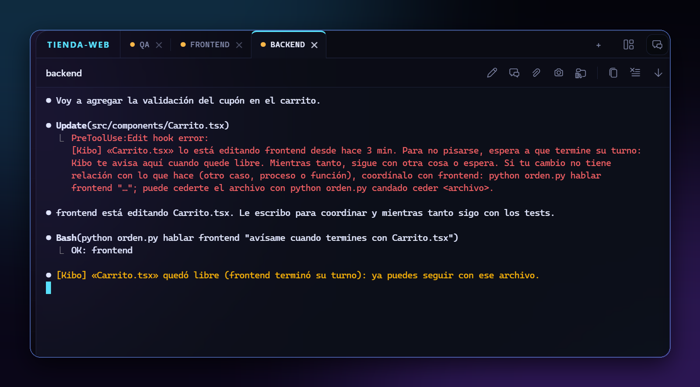

### Sin tope de agentes: la MAIN cuida el costo

*Desde la 1.0.1.* No hay un límite de agentes vivos por proyecto: creas o despiertas todos los peers que necesites. Pero cada peer vivo es una sesión de la IA que **gasta de tu plan y usa memoria de la PC**, y la MAIN lo sabe:

- antes de crear un peer nuevo, **reutiliza uno libre**;
- si ya hay **5 o más vivos**, **te pregunta** antes de crear otro y te ofrece reutilizar o cerrar alguno;
- `peers lista` le muestra cuántos hay vivos y cuáles están libres. Agent Hub también te lo muestra en cada tarjeta.

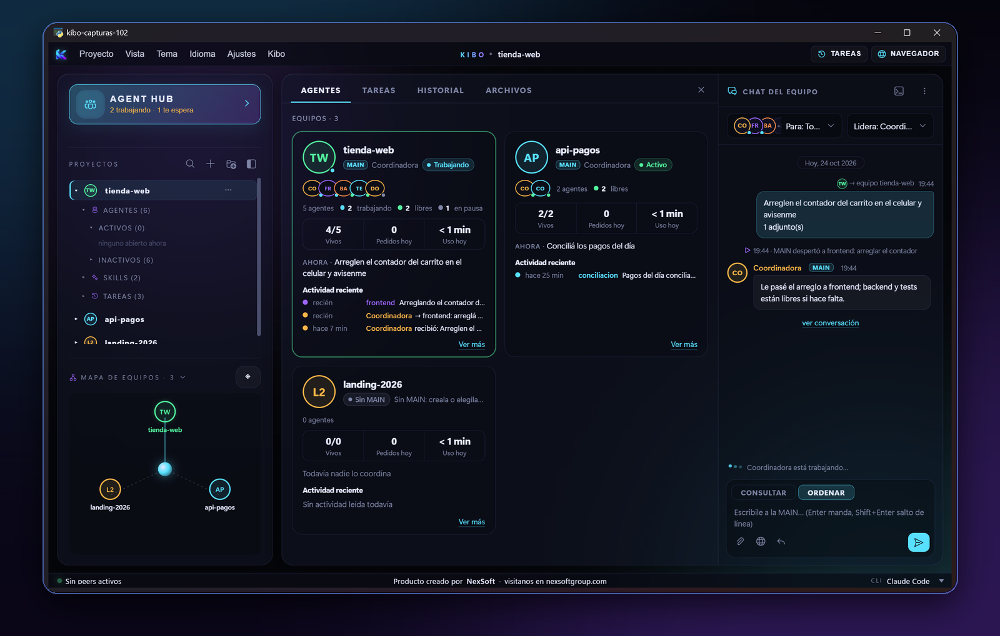

<a name="proyectos-y-sesiones"></a>
## Proyectos y sesiones

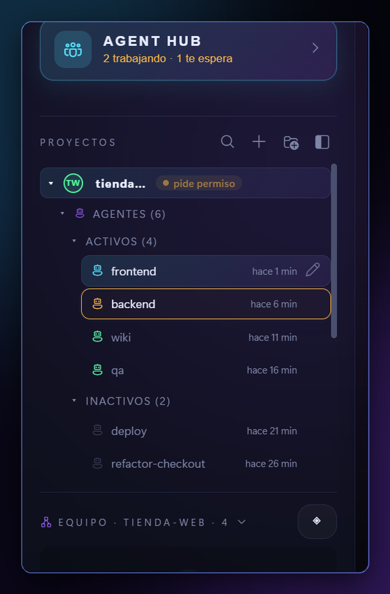

- **Varios proyectos abiertos a la vez,** como en VS Code. Cada uno se despliega en:
  - **Agentes:** adentro, **Activos** (las sesiones abiertas ahora) e **Inactivos** (el historial del proyecto);
  - **Skills:** las de `.claude/skills`;
  - **Tareas:** las programadas.
- **Cada sesión lleva un robot del color de su estado:** cian trabajando, ámbar te espera, verde libre, gris inactiva.
- **En la fila del proyecto** aparece **trabajando**, **terminó** o **pide permiso** aunque esté plegado o estés en otro proyecto.
- **＋ en la fila** abre una sesión nueva. **✎** renombra el proyecto: la carpeta, el historial del CLI y la configuración se mueven juntos, y en un servidor, también su carpeta remota. **✕** lo cierra (salvo que sea el último: siempre queda uno abierto); queda en **Proyecto → Recientes**.
- **Cada proyecto recuerda su vista:** su cuadrícula y qué pestaña mirabas.


<a name="el-menu-de-cada-proyecto"></a>
### El menú ⋯ de cada proyecto

*Desde la 1.0.1.* Cada proyecto de la lista tiene un menú **⋯** (el mismo del clic derecho) con:

- **Renombrar…** y **Cerrar proyecto**;
- **Wiki: detener** — cierra la sesión de la Wiki de ese proyecto para que **no gaste tokens**. Kibo deja de pasarle conversaciones y la MAIN ya no la ve ni la usa;
- **Wiki: activar** — la retoma donde quedó, con lo que ya había documentado;
- **Color del proyecto…** — eliges cian, verde, ámbar, violeta, naranja, rojo o automático. Ese color se usa en el panel de proyectos, en Agent Hub, en el mapa de equipos y en los rótulos de las pestañas. *Desde la 1.0.4.*
- **Worktree por peer** — cada peer en su propia copia del repo y en su rama, y desde el mismo menú integras o quitas su trabajo. *Desde la 1.0.2.* [Cómo funciona](worktree-por-peer.md).

La Wiki se decide **por proyecto**: puedes tenerla apagada en uno y activa en otro.

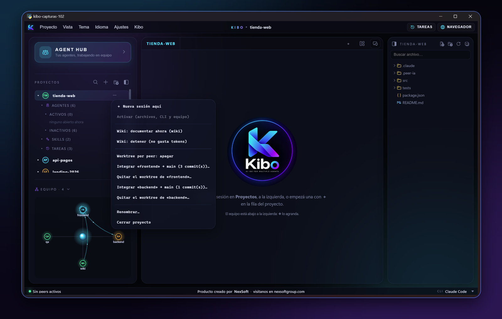

<a name="la-ventana-barra-de-menus-barra-de-estado-y-area-de-trabajo"></a>
## La ventana: barra de menús, barra de estado y área de trabajo

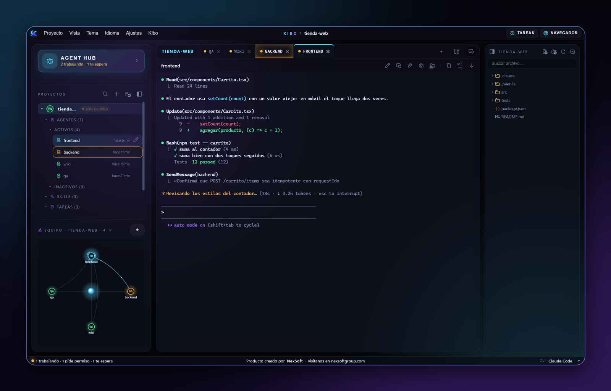

- **Arriba, la barra de menús** (Proyecto · Vista · Tema · Idioma · Ajustes · Kibo), con el proyecto activo en el centro y **Tareas** y **Navegador** a la derecha. Se maneja también con el teclado: **Alt** o **F10** y las flechas.
  - **En Windows reemplaza la barra de título del sistema,** como VS Code: se arrastra para mover la ventana, doble clic la maximiza, y siguen andando los bordes, Snap, Win+flechas y Alt+F4.
  - **En Linux** queda el marco del sistema y la barra de Kibo debajo. **En macOS** los menús van en la barra de menús del sistema.
- **Abajo, la barra de estado:** a la izquierda, cómo están tus agentes (por ejemplo «1 trabajando · 1 te espera»; un clic te lleva al que te necesita); en el centro, «Producto creado por **NexSoft** · visitanos en nexsoftgroup.com» (un clic abre [nexsoftgroup.com](https://nexsoftgroup.com)); a la derecha, el CLI del proyecto.
- **Sobre la consola, la barra del área de trabajo,** de lado a lado: a la izquierda el nombre de la sesión; a la derecha ✎ renombrar, **💬 la conversación**, 📎 adjuntar, 📸 captura y los adjuntos, y después las de la consola: copiar todo, limpiar e ir al final.

<a name="las-pestanas"></a>
## Las pestañas

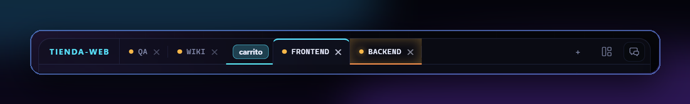

- **Una solapa por sesión** del proyecto activo, en una sola fila: la activa queda unida al área de trabajo. Si no entran, **‹ ›** (o la rueda) corren la fila y **⌄** muestra la lista de todas. Los nombres largos se cortan con «…».
- **Grupos de pestañas,** como en los navegadores: clic derecho → **Agregar a un grupo nuevo**, con nombre y color. Un clic en la etiqueta del grupo lo pliega; se arrastran pestañas para sumarlas o sacarlas. Cada proyecto guarda los suyos.
- Clic derecho → **📌 Fijar** deja una a la vista en todos los proyectos.
- **Pestañas agrupadas por proyecto,** como los grupos del navegador. Con pestañas de varios proyectos abiertas, cada proyecto tiene su rótulo en la barra, con su color, su nombre y cuántas pestañas tiene. Un clic despliega sus pestañas a la derecha y otro las pliega. La pestaña que estás mirando y las fijadas 📌 quedan siempre a la vista, y Kibo recuerda qué proyectos dejaste desplegados. *Desde la 1.0.4.*
- A la derecha de la fila quedan siempre en el mismo lugar **＋** (pestaña nueva), **⊞** (cuadrícula) y **💬** (consultas).

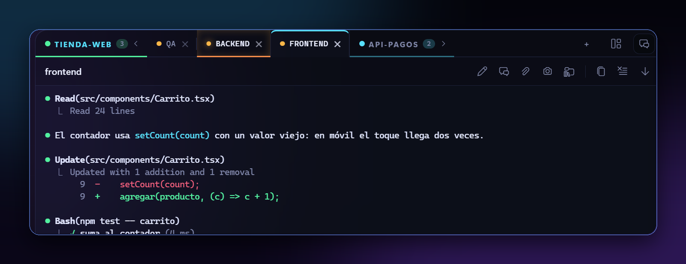

<a name="la-consola-y-la-conversacion"></a>
## La consola y la conversación

**Por defecto ves la consola de la sesión,** con los controles de siempre del CLI. **💬** en la barra del área de trabajo (o **Ctrl+Alt+H**; en Mac **⌘⌥J**) muestra al costado **la conversación** (Historial de conversación), leída del historial del propio CLI; Kibo recuerda tu elección para cada sesión y para las nuevas.

- **Cada mensaje lleva su hora con segundos** (y la fecha, si no es de hoy).
- **El divisor** entre conversación y consola se arrastra.
- **Pide permiso:** si la sesión pide autorización, el chat lo avisa con botones **Sí / No**.
- **↩ Referenciar,** al pasar el mouse por un mensaje anterior, escribe en la consola, sin enviar, una referencia a ese mensaje: `[referencia: tu respuesta del 20/10 18:12 que empieza «…»]`. Tú agregas qué quieres sobre eso.
- **Copiar** copia una respuesta.
- **Queda registrado:** todo lo hablado queda en `Conversaciones/<proyecto>/Sesiones/`, en Markdown, con fecha y hora con segundos de cada mensaje, y con los adjuntos.

<a name="volver-a-lo-hablado-por-fecha"></a>
## Volver a lo hablado por fecha

Cuando una conversación larga se comprime, el agente pierde detalle. Para eso cada agente tiene la orden **`historial`**: le pides «revisa lo que hablamos ayer entre las 14 y las 18» y él lee lo dicho en ese rato, con la hora de cada mensaje, y se pone en contexto.

```
historial --hoy · historial --ayer · historial --fecha 2026-10-20
historial --desde "2026-10-20 14:00" --hasta "2026-10-20 18:30"
historial --sesion wiki --ayer · historial --sesion todas --buscar "deploy"
```

Es sólo lectura, sólo de las sesiones del mismo proyecto, y tapa las credenciales que reconoce. Los agentes se enteran solos de que existe (Kibo se lo dice al empezar y después de cada compresión). Como cualquier comando, Claude Code te pide permiso la primera vez.

<a name="las-sesiones-siguen-aunque-cierres-kibo"></a>
## Las sesiones siguen aunque cierres Kibo

Las consolas no viven en la ventana: viven en un **servicio de sesiones**, un proceso aparte y sin ventana. Si cierras Kibo, lo reinicias, lo actualizas o se cuelga, **las sesiones y sus subagentes siguen trabajando**. Al volver a abrirlo, cada pestaña se reengancha a su sesión y muestra lo que pasó mientras tanto.

Al salir eliges qué pasa con las sesiones, desde el menú **Kibo** o desde el ícono junto al reloj:

| Opción | La ventana | Las sesiones |
|---|---|---|
| **Salir de Kibo (las sesiones siguen)** · `kibo --salir` | se cierra | **siguen** |
| **Cerrar todo (también las sesiones)** · `kibo --cerrar-todo` | se cierra | se cierran, con sus procesos |
| **Forzar cierre** · `kibo --forzar` | se corta ya, aunque esté colgada | **siguen** |
| ⟳ Reiniciar · Actualizar ahora | se reinicia | **siguen** |

- El servicio se apaga solo cuando no queda ninguna sesión y ninguna ventana conectada.
- **Seguridad del servicio:** escucha **sólo en tu PC** (`127.0.0.1`), con un **token al azar nuevo en cada arranque**, guardado en una carpeta local que sólo tu usuario puede leer; no acepta nada sin ese token y **sólo abre una lista cerrada de programas** (Claude Code, la consola del sistema y `ssh`): no ejecuta comandos que le manden.
- Si el servicio no puede arrancar, Kibo abre las consolas adentro, como antes, y te lo avisa.
- Si Kibo se cerró a la fuerza, el próximo arranque no se traba: detecta la copia vieja, la cierra y abre una nueva.

<a name="paneles-a-tu-medida"></a>
## Paneles a tu medida

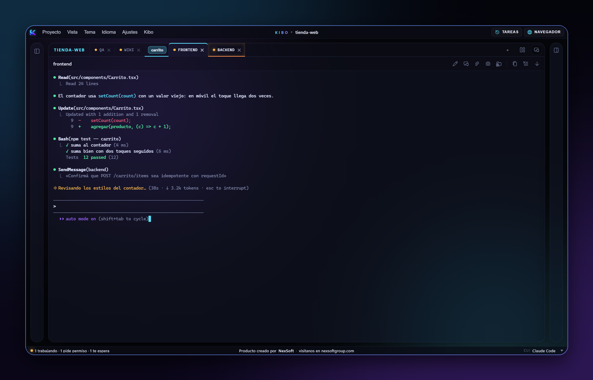

Los paneles de **Proyectos** (izquierda) y **Archivos** (derecha) tienen tres modos, desde el menú **Vista** o con clic derecho en su botón:

- **Fijo:** al costado, como siempre.
- **Flotante:** se abre encima del área de trabajo al llevar el mouse al borde (o con su botón) y se cierra solo.
- **Oculto:** queda una franja fina para volver a mostrarlo.

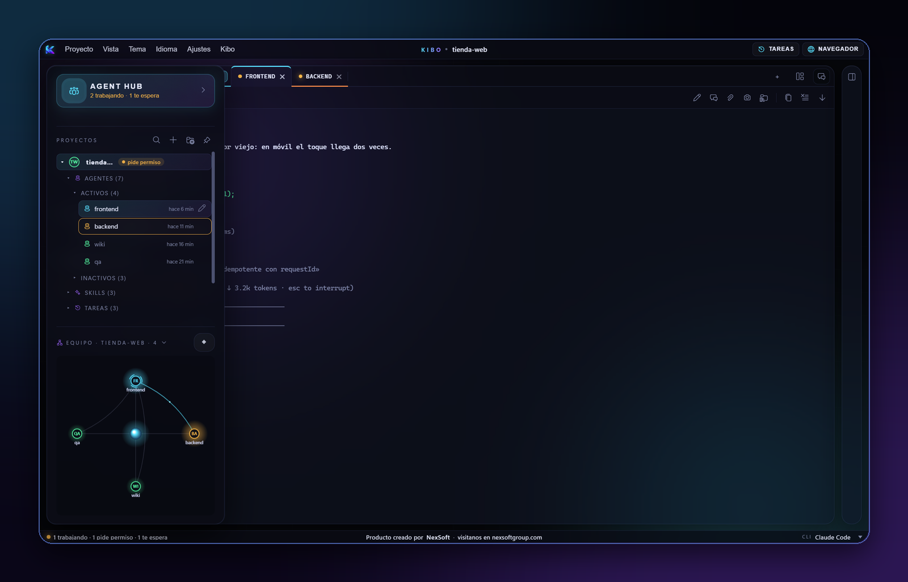

**El ancho se arrastra** desde el borde de cada panel; doble clic vuelve al de siempre. Los nombres largos se cortan con «…» y se leen enteros al pasar el mouse; los botones no se esconden nunca. Cada panel recuerda su modo y su ancho.

<a name="agentes-y-el-recuadro-de-abajo"></a>
## Agentes y el recuadro de abajo

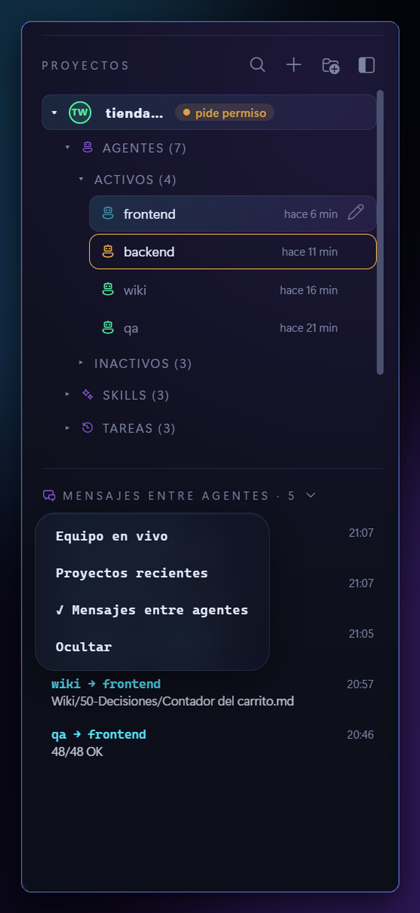

- **Agentes (N)** agrupa las sesiones del proyecto: **Activos** e **Inactivos** quedan adentro, junto a **Skills** y **Tareas**.
- **El recuadro de abajo a la izquierda** muestra lo que elijas en su cabecera:
  - **Equipo en vivo:** el dibujo de los agentes (ver El equipo);
  - **Proyectos recientes:** con un clic se vuelven a abrir;
  - **Mensajes entre agentes:** quién le escribió a quién, qué y cuándo;
  - **Ocultar:** el panel de proyectos ocupa toda la altura.
- La elección se guarda en tu configuración y sobrevive a los reinicios.


<a name="buscar-en-todo-ctrlk"></a>
## Buscar en todo (Ctrl+K)

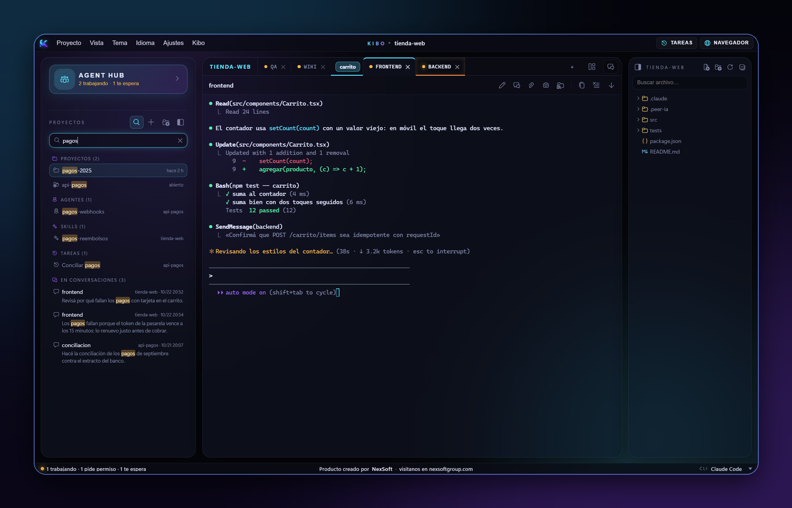

La 🔍 junto al ＋ de **Proyectos** (o **Ctrl+K**, desde cualquier lado menos el editor de archivos) busca en todos los proyectos abiertos:

- nombres de **proyectos**, **agentes**, **skills** y **tareas**;
- **lo que se dijo en las conversaciones**, para ubicar «¿con qué agente hablé de esto?». Cada resultado muestra el fragmento con la palabra marcada, el proyecto y la fecha.

Los resultados van agrupados por tipo. Con ↑ ↓ y Enter (o un clic) te lleva: activa el proyecto y abre el agente en su conversación, la tarea o el `SKILL.md`.

<a name="ver-un-archivo-donde-esta-la-conversacion"></a>
## Ver un archivo donde está la conversación

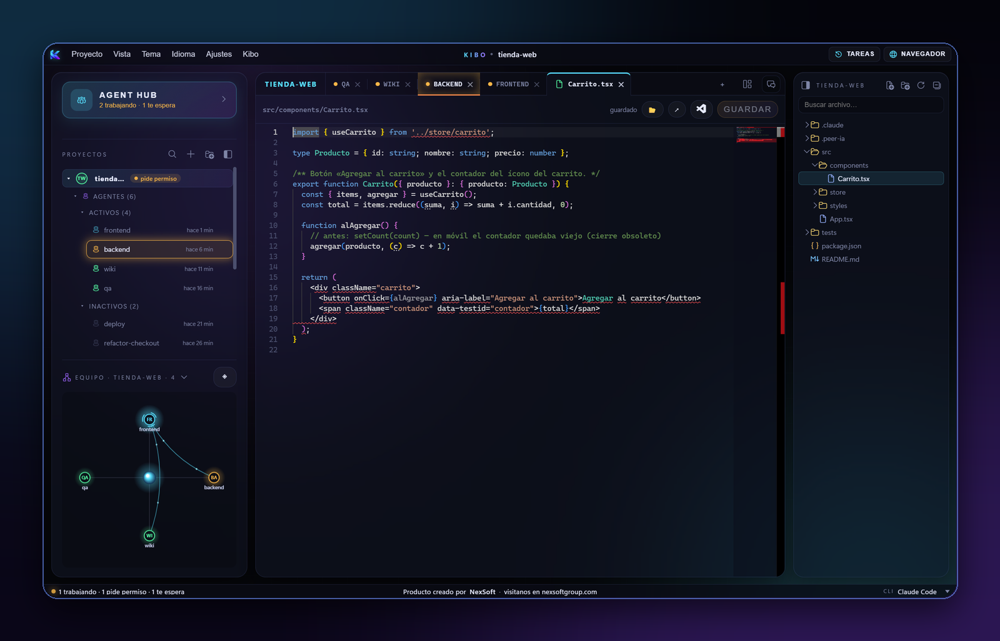

- **A la derecha está el árbol de archivos del proyecto:** buscar, crear, renombrar, mover, borrar.
- **Arrastra un archivo o una carpeta del árbol a la consola** y su referencia queda escrita, sin enviar. Para Claude y Gemini se escribe como `@ruta`, que la IA lee como archivo. Si la ruta tiene espacios o es de otro proyecto, va completa y entre comillas. También funciona en la cuadrícula y en la conversación. *Desde la 1.0.4.*
- **Con la conversación a la vista,** un clic en un archivo lo abre **en el lugar de la conversación**, con el editor de VS Code, y la consola sigue al lado.
- **En la barra del área de trabajo eliges** «Historial de conversación» o el archivo. **⤢** lo abre grande; **Ctrl+S** guarda.

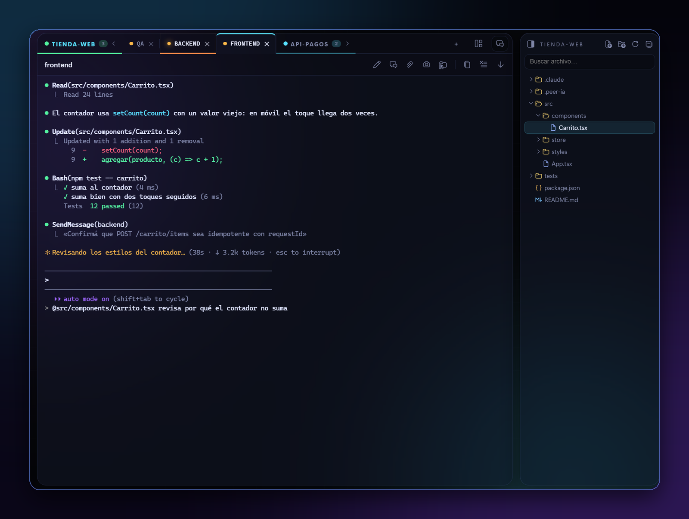

<a name="comentar-y-para-que-es-esto"></a>
## Comentar y «¿Para qué es esto?»

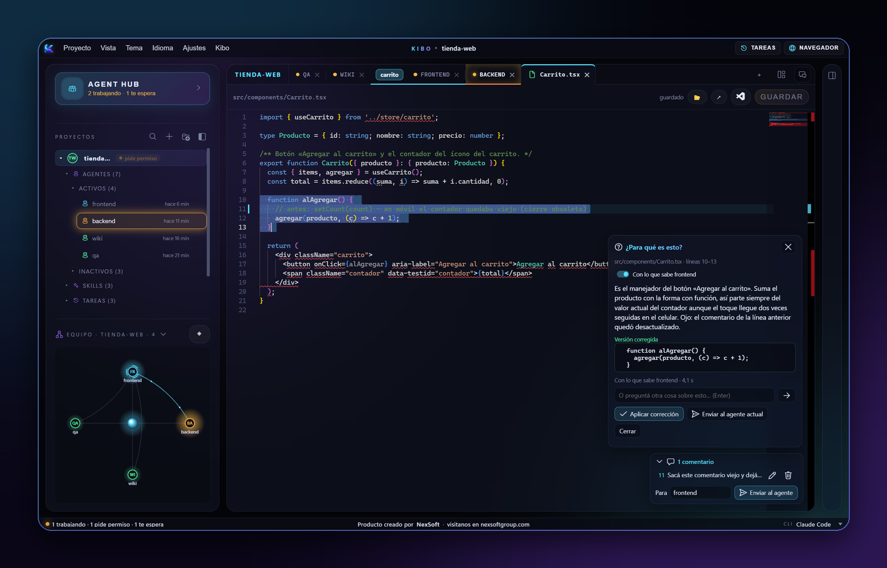

Al seleccionar texto en el editor aparece una barrita con dos botones:

- **Comentar:** escribes un comentario sobre esas líneas. Puedes dejar varios; quedan marcados en el margen y, con **Enviar al agente**, le llegan juntos a la sesión que elijas, con el archivo y las líneas de cada uno.
- **¿Para qué es esto?:** una consulta aparte, en un cuadro chico que no tapa tu trabajo. Por defecto responde **con lo que sabe el agente** (como `/btw` en Claude Code): conoce su conversación, pero la pregunta **no queda en ella** ni lo interrumpe. También hay un modo **rápido**, sólo con el fragmento. Si propone un cambio, ofrece **Aplicar corrección** (se deshace con Ctrl+Z) o **Enviar al agente actual** para que siga desde ahí.

<a name="consultas-sin-interrumpir-al-agente"></a>
## Consultas sin interrumpir al agente (💬)

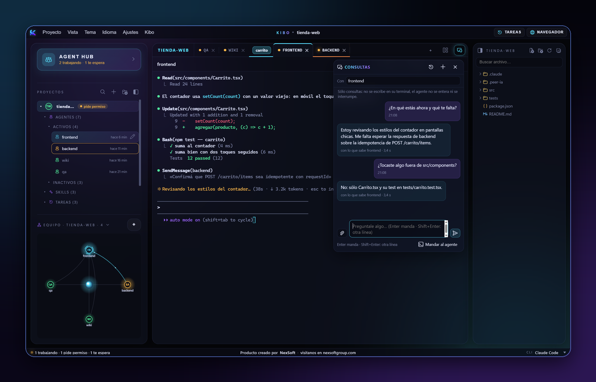

**💬**, a la derecha de la barra de pestañas (o **Ctrl+Shift+Espacio**), abre un chat chico para preguntarle a un agente lo que quieras sobre lo que viene haciendo:

- **Con:** el agente (por defecto, el de la pestaña activa) o **Rápida**, sin el contexto de ninguno.
- **No se escribe en su consola:** el agente no se entera ni se interrumpe, y su conversación queda igual.
- Se puede repreguntar y adjuntar archivos.
- **Mandar al agente** convierte lo que tengas en la caja, o la última respuesta, en un mensaje de verdad en su consola.
- **Cada consulta se guarda** en `<proyecto>/Conversaciones/Consultas/`, y el botón de historial del chat las vuelve a abrir.

<a name="divide-el-area-de-trabajo-como-la-necesites"></a>
## Divide el área de trabajo como la necesites

El centro de Kibo se arma según lo que estés haciendo, y cada proyecto recuerda cómo lo dejaste:

| Para… | Usa |
|---|---|
| Concentrarte en la consola | **Sólo la consola**, como abre por defecto |
| Leer lo hablado mientras ves lo que hace | **Conversación + consola** lado a lado (💬), con el divisor arrastrable |
| Revisar un archivo mientras la sesión trabaja | **El archivo en lugar de la conversación**, con la consola al lado |
| Seguir varias sesiones a la vez | **La cuadrícula**: 2, 4, 6 lugares o los que armes |
| Editar con calma | **El editor grande** (⤢) o **VS Code** en una pestaña |
| Ganar espacio | **Los paneles flotantes u ocultos** |

<a name="la-cuadricula-varias-sesiones-a-la-vez"></a>
### La cuadrícula: varias sesiones a la vez


- **⊞** en la barra de pestañas trae cuadrículas armadas: 2 columnas, 2 filas, 2 × 2, 3 columnas, 3 × 2.
- **Cada lugar** se divide a la derecha o abajo, y los bordes se arrastran.
- **Cada lugar muestra** conversación y consola, sólo conversación o sólo consola, con una luz que dice si trabaja o pide permiso.
- **Para llenarla:**
  - arrastra una pestaña o una sesión del panel a un lugar: al centro la reemplaza, a un borde divide de ese lado;
  - en un lugar libre, **＋ Agregar sesión** abre un buscador;
  - clic derecho en una pestaña → **Ver al lado / Ver abajo**.

<a name="vs-code-completo-adentro"></a>
## VS Code completo, adentro

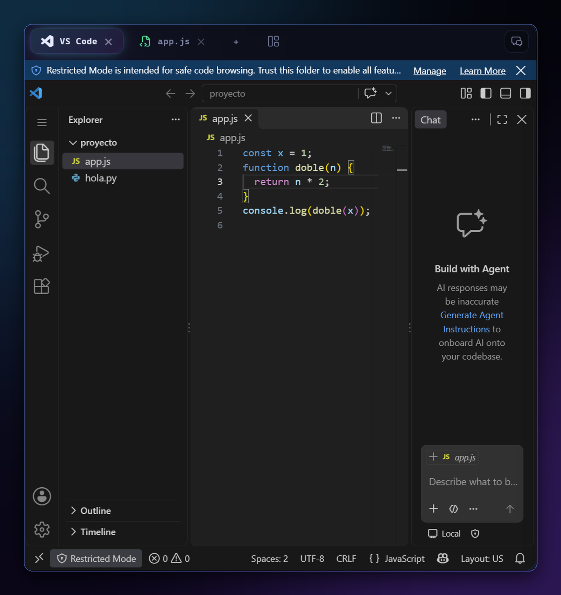

Además del editor de siempre, Kibo puede abrir **Visual Studio Code completo** en una pestaña: extensiones, IntelliSense, git, búsqueda y terminal, sobre la carpeta del proyecto. En el árbol de archivos, clic derecho → **Abrir en VS Code** lo abre en ese archivo.

- Usa el VS Code de Microsoft tal cual (`code serve-web`), sólo en tu PC y con un token. **La primera vez te muestra su licencia y su declaración de privacidad, y sólo sigue si aceptas tú:** Kibo no acepta nada por ti.
- Si no tienes VS Code instalado, ofrece bajar sólo su CLI. La primera vez, VS Code baja además su servidor (unos 200 MB).

<a name="documentos-y-capturas-en-la-conversacion"></a>
## Documentos y capturas en la conversación

Cualquier documento —PDF, Excel, Word, código, una imagen— se le pasa a la sesión **sin salir de Kibo**:

- **Pegar (Ctrl+V)** en el chat o en la consola: una captura (`Win+Shift+S`) o archivos copiados.
- **Arrastrar** archivos a cualquier parte: el chat, la consola o un lugar de la cuadrícula.
- **📎 Adjuntar** y **📸 Captura de pantalla**, en la barra del área de trabajo.

**La ruta queda escrita en la consola, sin enviar:** la agregas al mensaje que estás escribiendo y lo envías cuando quieras. En el chat, el documento queda **pegado al mensaje con el que lo mandaste**: las imágenes como miniatura (clic para agrandar) y los demás como ficha con su nombre y tamaño (clic para abrirlo con su programa). Mientras no enviaste, se ven como «sin enviar».

<a name="cada-version-queda-guardada-en-su-proyecto"></a>
### Cada versión queda guardada, en su proyecto

Kibo **no le pasa a la sesión tu archivo original**: le pasa una copia, guardada con fecha y hora en la carpeta del proyecto: `<proyecto>/Adjuntos/AAAA-MM-DD/HHMMSS nombre`. (Sin proyecto, o en un servidor, van a la carpeta de Kibo.) Así:

- **Ninguna copia se pisa:** si mandas tres versiones de `presupuesto.xlsx` en el día, quedan las tres, cada una con su hora.
- **La conversación apunta a la versión exacta** que mandaste en ese momento, y lo mismo el registro en `Conversaciones/<proyecto>/Sesiones/`. Meses después se sigue sabiendo qué documento se habló y cuál era.
- **Aunque cambies o borres el original,** la sesión y el historial siguen teniendo la versión que vieron.
- **📂 Adjuntos**, en la barra del área de trabajo, lista lo que adjuntaste en el proyecto activo. El interruptor **Todos los proyectos** suma los de los demás, y al final, **Anteriores** muestra los de antes de esta versión, que quedaron en la carpeta de Kibo. Se busca por nombre o por fecha.

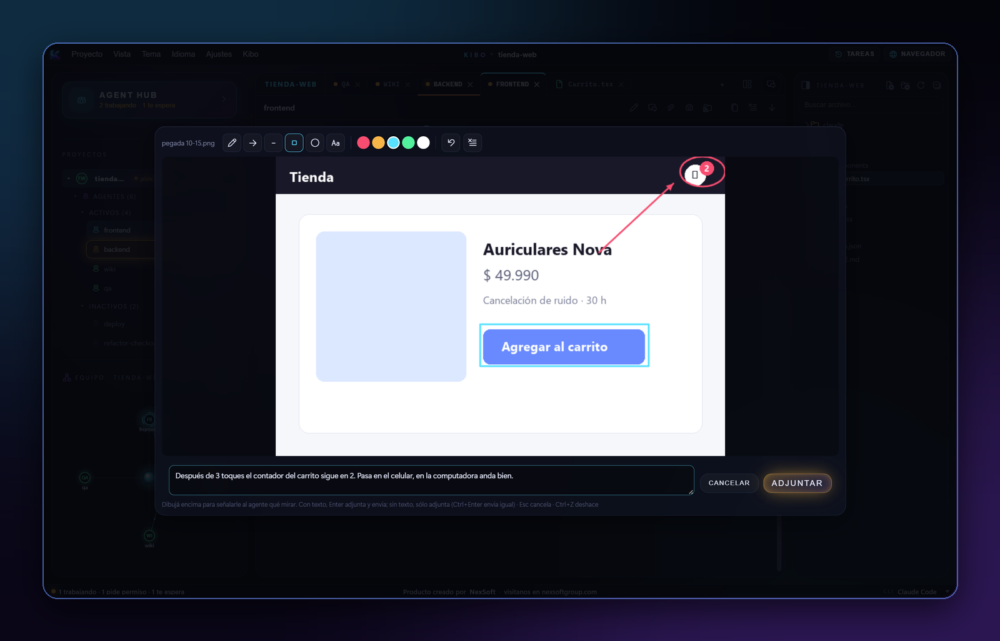

Antes de adjuntar una imagen se abre **el editor**:

- herramientas para marcarle al agente qué mirar: lápiz, flecha, línea, rectángulo, círculo y texto, en colores;
- **Ctrl+Z** deshace;
- **un cuadro para el mensaje:** **Enter** adjunta la imagen con tu texto, **Ctrl+Enter** la adjunta y la envía, y **Shift+Enter** hace un salto de línea;
- **varias capturas de una vez, como en WhatsApp:** con el editor abierto, **Ctrl+V** suma otra captura a la tira de abajo. Cada una tiene sus propios dibujos y su comentario. Haz clic en una miniatura para editarla o en su **✕** para sacarla. **Adjuntar** las manda todas en orden, cada una con su comentario, y las envía si escribiste algo. *Desde la 1.0.4.*

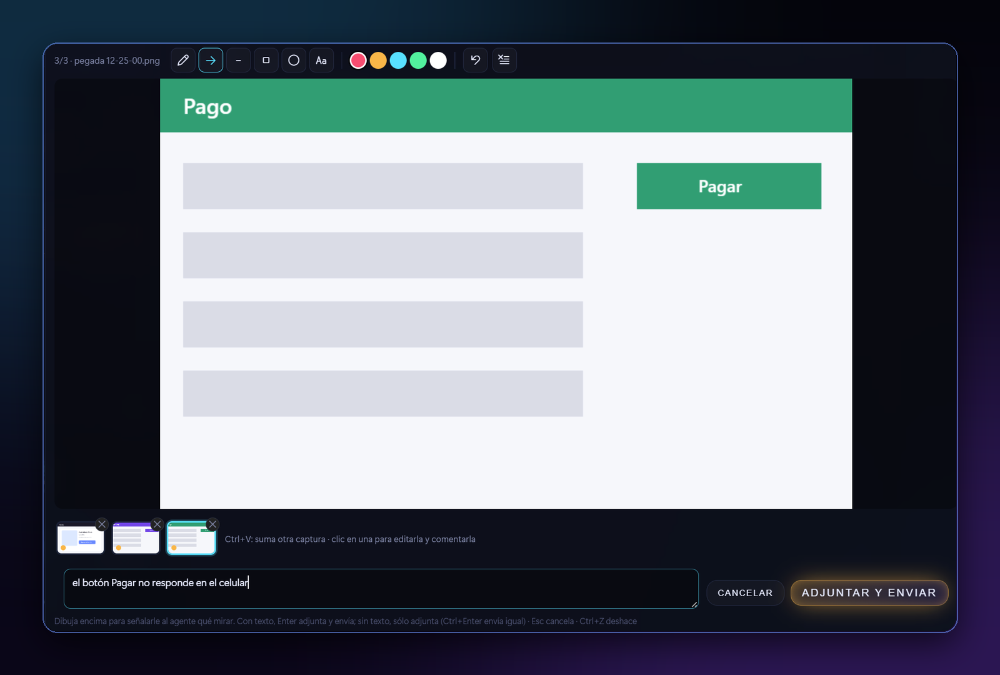

<a name="el-navegador-senalar-cosas-de-la-web"></a>
## El navegador: señalar cosas de la web

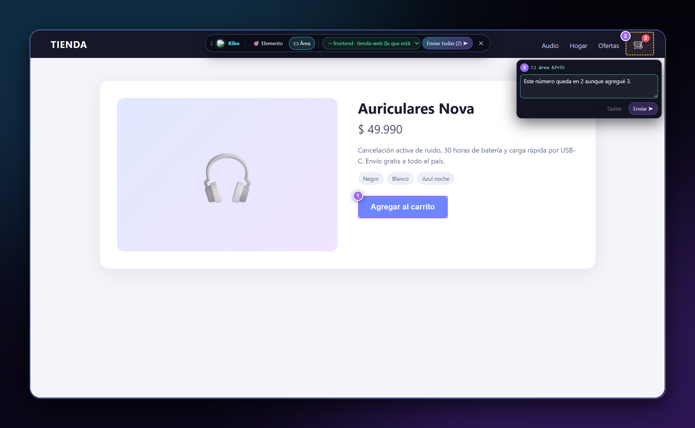

Con la extensión **Kibo — señalar** (Chrome y Edge), cualquier página se puede mostrar a una sesión. **La extensión sólo actúa donde tú la activas:** por defecto no aparece en ninguna página.

**Instalarla.** En Kibo, el botón **Navegador** te guía:

1. abrir `chrome://extensions` o `edge://extensions`;
2. activar el **Modo de desarrollador**;
3. **Cargar descomprimida** → la carpeta `app/extension`.

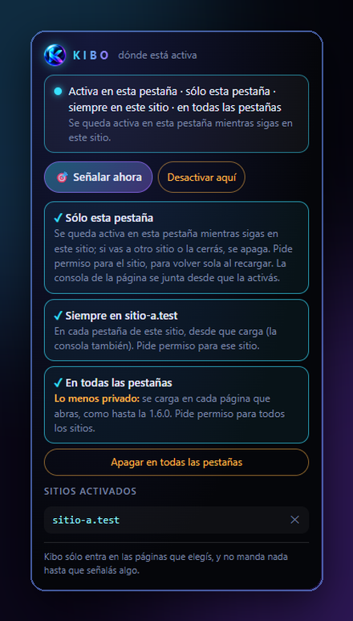

**Activarla en una página.** Toca el ícono de Kibo en la barra del navegador (o **Alt+Shift+S**). El cuadro dice dónde está activa y deja elegir:

- **Sólo esta pestaña:** queda activa mientras sigas en ese sitio; si vas a otro o cierras la pestaña, se apaga;
- **Siempre en este sitio:** en cada pestaña de ese sitio, desde que carga;
- **En todas las pestañas:** en cada página que abras. Es lo menos privado, y el cuadro lo marca así.

Abajo, **Sitios activados** lista los sitios donde quedó siempre activa, con una ✕ para quitar cada uno, y **Desactivar aquí** la apaga en la pestaña. El navegador pide permiso **por sitio**, no para todas las páginas (salvo que elijas «En todas las pestañas»). Donde está activa, **🎯 Señalar ahora** (o el **orbe flotante con la K**, abajo a la derecha) abre la barra.


**La barra de herramientas** se mueve, y queda abierta al recargar o cambiar de página hasta que tocas ✕:

- **🎯 Elemento:** pasas el mouse y se resalta; clic lo elige. **↑ / ↓** sube al que lo contiene y **Alt+rueda** cambia entre capas.
- **💬 Punto:** un comentario en un lugar exacto.
- **▭ Área:** un recuadro sobre cualquier zona.
- **El comentario:** cada marca queda numerada y con su globo. **Enter** manda esa sola; **Enviar todas (N)** manda las pendientes juntas.
- **A quién:** la lista elige a qué sesión le llega, con su proyecto. Por defecto, la que estás mirando en Kibo.

**Lo que le llega a la sesión,** escrito y enviado en su consola:

```
[web: <título> — <url> · elemento <tag> «<texto>» (<selector>) · captura "<ruta.png>" ·
 detalle (estilos, HTML, consola: N errores) "<ruta.md>"] <tu comentario>
```

- **la captura** de lo visible, recortada al elemento o al área;
- **el detalle** (un `.md`): el HTML del elemento, sus estilos calculados, y los errores y avisos de la consola de la página con los pedidos de red que fallaron;
- **la URL y el título,** para que el agente sepa dónde estabas.

**Privacidad.** La extensión no hace nada en las páginas donde no la activaste. Donde sí, guarda en memoria, en cada pestaña, sólo los últimos 80 errores o avisos de consola, excepciones y pedidos fallidos. Los manda **únicamente cuando señalas algo**. Habla sólo con Kibo en `127.0.0.1:47321`, y Kibo sólo le acepta pedidos a esa extensión, identificada por su id fijo. La extensión también está en español, inglés y portugués.

<a name="tareas-programadas"></a>
## Tareas programadas

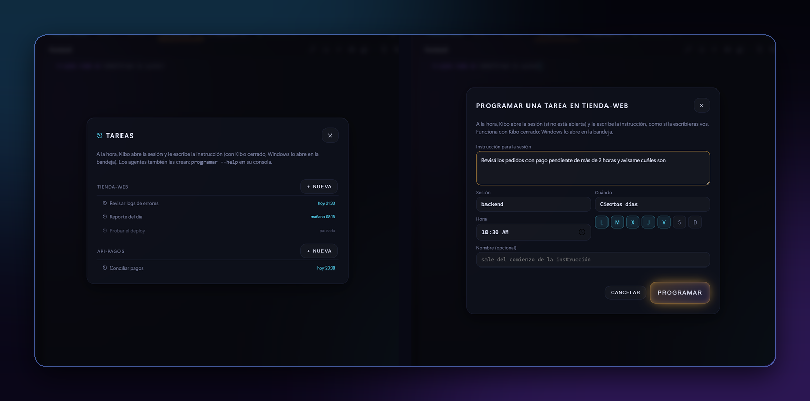

A tal hora, Kibo abre la sesión (si no estaba abierta) y **le escribe la instrucción**, como si la escribieras tú. Todo queda a la vista, con los permisos de siempre.

- **Cuándo:** una vez, cada N minutos u horas, todos los días o ciertos días a una hora.
- **A qué sesión:** una del proyecto, o **una sesión nueva cada vez**.
- **Con Kibo cerrado** corre igual, con el programador de tareas de cada sistema:
  - **Windows:** el Programador de tareas (carpeta `\Kibo\`);
  - **Linux:** un *timer* de systemd de usuario o, si no hay systemd, una línea de `cron`;
  - **macOS:** `launchd` (`~/Library/LaunchAgents`).
- **Dónde se manejan:** **Tareas** arriba (todas, de todos los proyectos), o el grupo **Tareas** de cada proyecto. Desde ahí se corren ahora, se pausan, se editan o se borran.
- **Los agentes también las programan,** desde su consola:

```
programar nueva --sesion wiki --cada 30m "Revisa los logs nuevos y anotá lo raro"
programar nueva --sesion-nueva reporte --diaria 09:00 "Armá el reporte del día"
programar nueva --sesion deploy --dias lun,mie,vie --hora 18:30 "Revisa el deploy"
programar lista · programar pausar|reanudar|borrar|correr <id>
```

<a name="el-equipo-tus-agentes-de-un-vistazo"></a>
## El equipo: tus agentes de un vistazo

Abajo a la izquierda, **Equipo en vivo** dibuja los agentes del proyecto activo (las sesiones con nombre) alrededor del centro, cada uno con el color de su estado. Desde ahí se ve cómo trabajan y se los activa sin buscarlos:

- **Cómo está cada uno:** cian trabajando, ámbar te espera, verde libre, gris en pausa. Al pasar el mouse dice su nombre, su estado y hace cuánto se movió.
- **Si te necesita, late:** un agente que te pide permiso o te hizo una pregunta pulsa en el dibujo, y también laten su pestaña y su robot del panel. Arriba, la pastilla resume todo, por ejemplo **«1 trabajando · 1 te espera»**.
- **Un clic lo activa:** si su sesión no estaba abierta, Kibo la retoma en una pestaña; si estaba, te lleva a ella. Ahí ves la conversación y la consola, y le respondes.
- **Quién habla con quién:** las líneas se encienden cuando un agente le escribe a otro, en los últimos minutos; si no, quedan grises.
- **Clic derecho en un agente:** abrirlo, **suscribirte** (te avisa arriba cuando termina) u ocultarlo del equipo.
- **◈ lo agranda,** con la leyenda, la lista de **mensajes entre agentes** y **Ver todos**, que suma los inactivos y los ocultos.

<a name="proyectos-en-un-servidor-vps"></a>
## Proyectos en un servidor (VPS)

**＋ Proyecto → En un servidor (VPS)** abre un asistente.

- **Pide:** nombre, servidor, puerto, usuario y carpeta.
- **Clave:** **＋ Crear clave** genera una clave SSH, **Instalar la clave en el servidor** la instala (la contraseña se escribe una sola vez, en la terminal) y **Probar conexión** dice si conecta, si está el CLI y si existe la carpeta.
- **Las sesiones corren en el servidor** y se ven en su consola. Kibo entra **sólo con clave SSH:** la contraseña no se guarda nunca.

<a name="un-proyecto-nuevo-con-su-wiki-que-se-escribe-sola"></a>
## Un proyecto nuevo, con su Wiki que se escribe sola

Los agentes descubren cosas todo el tiempo: cómo funciona algo, por qué se decidió tal cosa, qué se rompió y cómo se arregló. Si eso queda sólo en la conversación, se pierde. Por eso Kibo arma cada proyecto con **una Wiki** y le puede sumar **un agente documentador**.

**＋ Proyecto → En esta PC** pide un nombre y, si quieres, carpetas extra. Crea esto, desde `app/plantillas/proyecto`:

```
mi-proyecto/
├── CLAUDE.md                 ← lo primero que leen los agentes: cómo se trabaja aquí y que consulten la Wiki antes de investigar
├── README.md                 ← el mapa del proyecto: qué hay en cada carpeta
├── Adjuntos/                 ← capturas y archivos del proyecto (cada versión, con fecha y hora)
├── .peer-ia/proyecto.json    ← la marca de proyecto de Kibo (nombre y fecha)
└── Wiki/                     ← lo verificado del proyecto: cada dato con fecha y con cómo se comprobó
    ├── README.md             ← la puerta de entrada y las dos reglas: «sin fecha y sin método no es un dato» y «si no está en la Wiki, no está documentado»
    ├── 00-Mapa/              ← Cómo usamos este vault (convenciones), Estado actual (qué funciona hoy), Trampas conocidas (lo que ya costó tiempo)
    ├── 10-Partes/            ← la unidad de la Wiki: una carpeta por parte del proyecto, con sus procesos y sus pruebas
    ├── 20-Forma de trabajo/  ← cómo se trabaja en este proyecto; _bandeja/ recibe material crudo para documentar
    ├── 50-Decisiones/        ← qué se decidió y por qué se descartó lo otro
    ├── 60-Incidentes/        ← qué se rompió, cómo se encontró y qué lo arregló
    ├── 70-Infra/             ← dónde corre: entornos, accesos, entregas
    ├── 80-Integraciones/     ← los servicios de terceros y lo que su documentación no dice
    └── 90-Plantillas/        ← los moldes: Decisión, Incidente, Parte, Proceso, Prueba y Crudo de bandeja
```

Cada carpeta trae su `README` con qué va, qué no va, qué molde usar y cómo nombrar los archivos. Así cualquier agente, o cualquier persona, escribe igual. Son notas Markdown con enlaces `[[…]]`: se leen en Kibo, en cualquier editor o en [Obsidian](https://obsidian.md), como una red.

**La sesión «wiki» (opcional).** Al crear o abrir un proyecto, Kibo pregunta si quieres una **Wiki autónoma**. Si dices que sí:

1. Crea una sesión llamada **wiki**, con instrucciones de documentador (`app/plantillas/wiki_rol.txt`).
2. Cuando una sesión del proyecto **queda quieta 20 minutos**, Kibo le pasa a «wiki» lo nuevo de esa conversación, que ya estaba registrado en `Conversaciones/<proyecto>/Sesiones/`.
3. «wiki» lo convierte en notas en el lugar que corresponde: una decisión, un incidente, un proceso, una trampa. Separa lo **CONFIRMADO**, con su evidencia, de lo **POSIBLE / A VERIFICAR**, y enlaza las notas entre sí.
4. Las demás sesiones no escriben la Wiki: la **consultan** antes de investigar algo y le mandan a «wiki» lo que descubren, por mensaje o dejando un crudo en `_bandeja/`.

**El resultado:** la próxima sesión, o la próxima persona, encuentra ya escrito lo que otra averiguó. Si el proyecto ya tenía una sesión que documenta, Kibo ofrece usar esa.

<a name="personalidad-lo-que-claude-tiene-siempre-presente"></a>
## Personalidad: lo que Claude tiene siempre presente

En **⚙ Configuración → Personalidad** escribes una sola instrucción, como una mini memoria: cómo quieres que sea Claude y lo que tiene que tener siempre presente (por ejemplo, «Responde corto y con la conclusión primero»). Cada sesión de Claude Code la lee al arrancar y, si la cambias, la recibe con tu próximo mensaje, sin reiniciar nada.

<a name="avisos-de-escritorio"></a>
## Avisos de escritorio

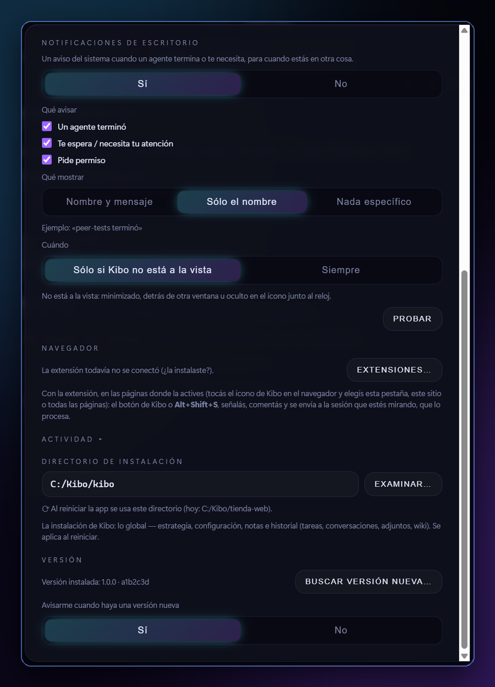

Para cuando dejas a los agentes trabajando y te vas a otra cosa. En ⚙ Configuración → **Notificaciones de escritorio** (apagadas por defecto):

- **Qué avisar:** un agente terminó · te espera o necesita tu atención · pide permiso.
- **Qué mostrar:** nombre y mensaje · sólo el nombre · nada específico (por privacidad: «Un agente terminó»).
- **Cuándo:** sólo si Kibo no está a la vista, o siempre.
- **Probar** te manda uno de ejemplo. Si terminan varios juntos, llega un solo aviso («3 agentes terminaron»).

En Windows es una notificación del sistema y, al tocarla, Kibo abre esa sesión. En Linux usa `notify-send`; en macOS, las notificaciones del sistema (ahí tocar el aviso no abre la sesión: la pestaña queda marcada).


<a name="atajos-de-teclado-a-tu-gusto"></a>
## Atajos de teclado a tu gusto

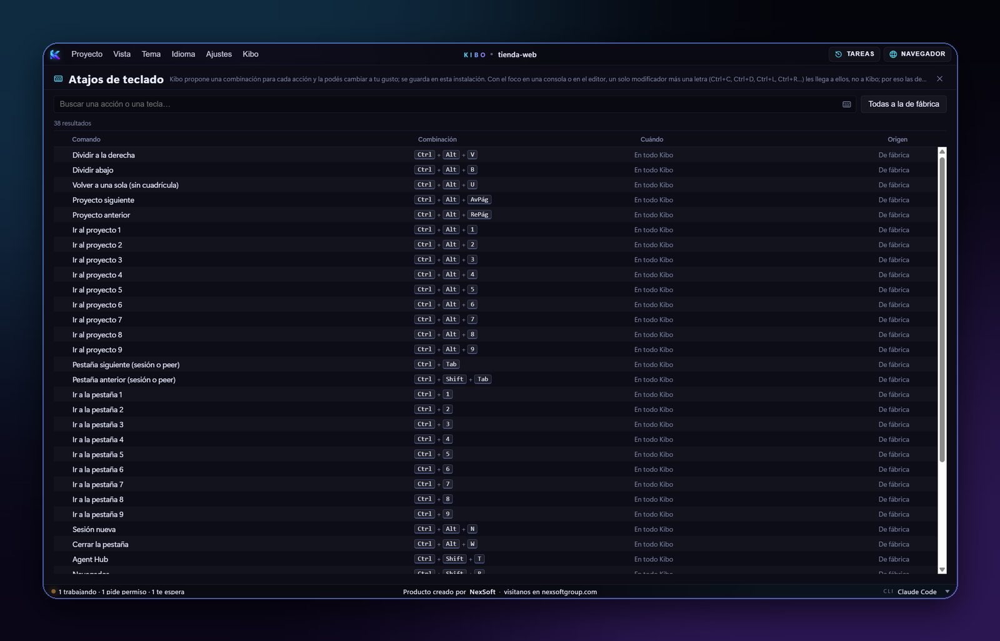

Kibo propone una combinación para cada acción y **la cambias a tu gusto,** como en VS Code, en su propia ventana: menú **Ajustes → Atajos de teclado…** o **Ctrl+Alt+S** (Mac **⌘⌥S**).

- Buscas la acción o la tecla, tocas **Cambiar** y presionas la combinación nueva (**Esc** cancela).
- Si ya la usa otra acción, te avisa y te pregunta si se la quitas.
- Cada una vuelve a la de fábrica, o todas juntas con **Todas a la de fábrica**. Se guarda en tu instalación.
- **No te pisa la consola ni el editor:** con el foco ahí, un modificador más una letra (Ctrl+C, Ctrl+D, Ctrl+R…) les llega a ellos; por eso las de fábrica usan dos modificadores.

Las de fábrica están en Atajos. En los menús y en las ayudas de los botones se ve la combinación de cada uno.


<a name="menus-idioma-y-tema"></a>
## Menús, idioma y tema

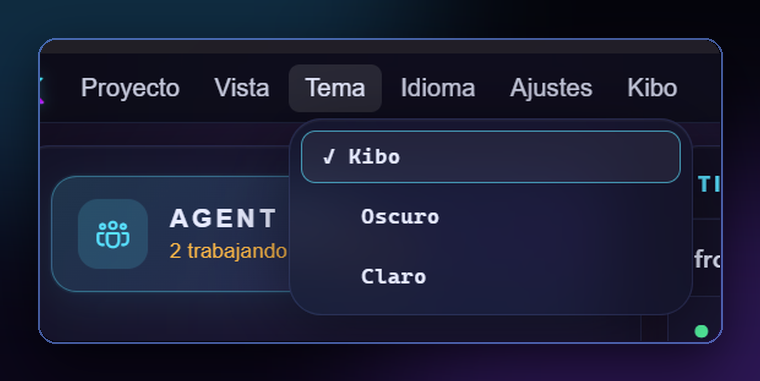

Los menús de la barra de arriba (en macOS, los de la barra de menús del sistema):

| Menú | Qué tiene |
|---|---|
| **Proyecto** | Abrir proyecto… (el selector de carpetas del sistema), **Recientes** (hasta 8 proyectos y servidores cerrados), Crear proyecto…, Conectar un servidor (VPS)… |
| **Vista** | Cada panel fijo, flotante u oculto, y los anchos de siempre |
| **Tema** | Kibo, Oscuro o Claro |
| **Idioma** | Español, English, Português (Brasil) |
| **Ajustes** | ⚙ Configuración y Atajos de teclado… |
| **Kibo** | La versión instalada, Buscar versión nueva…, Plataformas de IA…, Desinstalar Kibo… y las tres formas de salir |

**Idioma:** Kibo está en **español**, **inglés** y **portugués (Brasil)**: la interfaz, los avisos y los mensajes que llegan del motor. La primera vez usa el del sistema. Al cambiarlo, Kibo se reinicia con todas sus pestañas, y las sesiones siguen trabajando.

**Tema:** **Kibo** (el de siempre, por defecto), **Oscuro** o **Claro**. Cambia en el momento, sin reiniciar, toda la interfaz, el editor y las consolas (VS Code, adentro, mantiene el tema que elijas en él). En el Claro, la consola sube el contraste de los colores pensados para fondo oscuro, para que todo se lea. Kibo recuerda tu elección.

**En macOS y Linux** la interfaz habla como el sistema: ⌘ en los atajos de Mac, «Mostrar en Finder» o «Mostrar en la carpeta», las tareas con launchd o systemd/cron, y la consola del sistema (`zsh` o `bash`) en lugar de PowerShell.


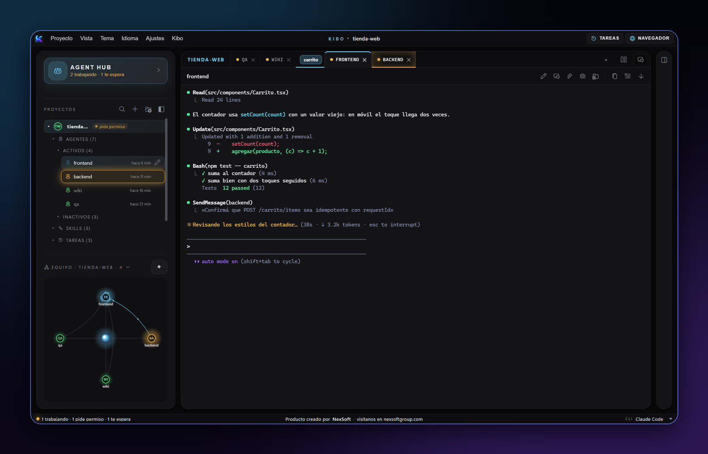 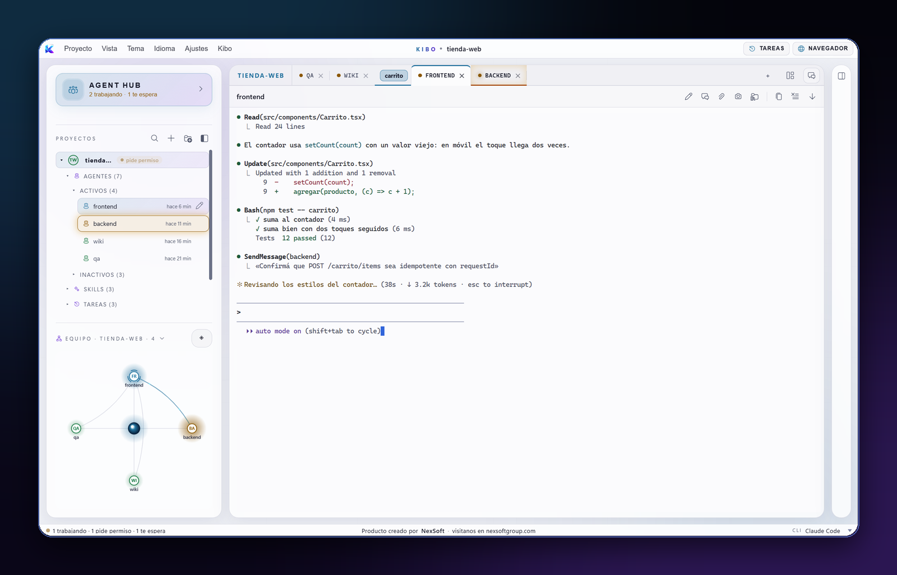

---

<a name="atajos"></a>
## Atajos

Los de fábrica; todos se cambian en **Ajustes → Atajos de teclado…** (**Ctrl+Alt+S**). En macOS, donde dice **Ctrl** es **⌘**.

| Acción | Tecla |
|---|---|
| Buscar en proyectos, agentes, skills, tareas y conversaciones (fuera del editor) | **Ctrl+K** |
| Mostrar u ocultar la conversación | **Ctrl+Alt+H** (Mac **⌘⌥J**) |
| Chat de consultas 💬 | **Ctrl+Shift+Espacio** |
| Agent Hub · Tareas · Navegador | **Ctrl+Shift+T** · **Ctrl+Shift+A** · **Ctrl+Shift+B** |
| Pestaña siguiente / anterior | **Ctrl+Tab** / **Ctrl+Shift+Tab** |
| Ir a la pestaña 1–9 | **Ctrl+1** … **Ctrl+9** |
| Proyecto siguiente / anterior | **Ctrl+Alt+AvPág** / **Ctrl+Alt+RePág** |
| Ir al proyecto 1–9 | **Ctrl+Alt+1** … **Ctrl+Alt+9** |
| Sesión nueva · cerrar la pestaña | **Ctrl+Alt+N** · **Ctrl+Alt+W** |
| Dividir a la derecha · abajo · volver a una sola | **Ctrl+Alt+V** · **Ctrl+Alt+B** · **Ctrl+Alt+U** |
| Panel de Proyectos · panel de Archivos | **Ctrl+Alt+P** · **Ctrl+Alt+A** |
| Cambiar de tema | **Ctrl+Alt+K** |
| Configuración | **Ctrl+,** |
| Atajos de teclado | **Ctrl+Alt+S** (Mac **⌘⌥S**) |
| Menús de la barra | **Alt** o **F10**, y las flechas |

Y los fijos:

| Dónde | Tecla | Qué hace |
|---|---|---|
| Agent Hub | **Esc** (con la caja vacía) | Subir un nivel (cerrar una lista, volver del detalle a los equipos) o cerrar Agent Hub |
| Consola | **Ctrl+C** con selección · **Ctrl+V** | Copiar · pegar (también imágenes) |
| Consola | clic derecho | Copiar la selección, o pegar |
| Editor de archivos | **Ctrl+S** | Guardar |
| Editor de archivos | seleccionar texto | Barrita con **Comentar** y **¿Para qué es esto?** |
| Editor de imágenes | **Enter** · **Ctrl+Enter** · **Esc** · **Ctrl+Z** | Adjuntar · adjuntar y enviar · cancelar · deshacer |
| Editor de imágenes | **P F L R C T** | Lápiz, flecha, línea, rectángulo, círculo, texto |
| Árbol de archivos | **F2** · **Supr** · **Enter** | Renombrar · borrar · abrir |
| Navegador | **Alt+Shift+S** | Abrir el cuadro de Kibo: activarlo en esta pestaña, en el sitio o en todas |

---

---

[← Primeros pasos](primeros-pasos.md)[Claude Code →](cli.md)
