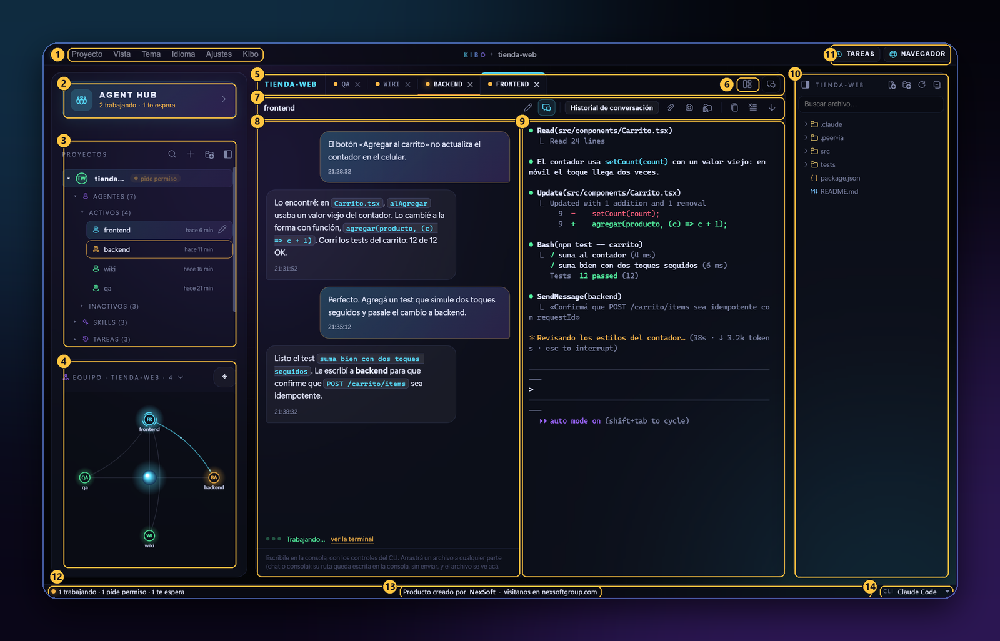
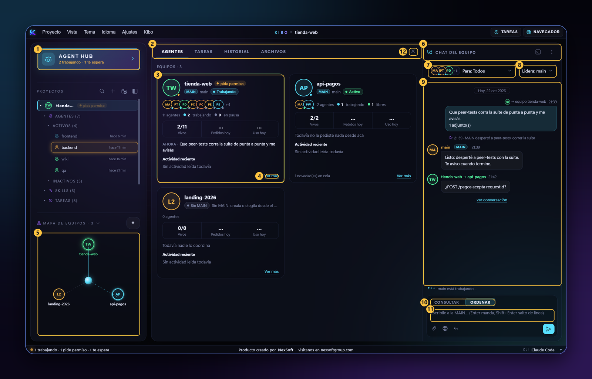

# Manual de uso

Qué hay en la ventana de Kibo, dónde está cada cosa y cómo sacarle provecho. Si recién lo instalaste, empieza por [Primeros pasos](primeros-pasos.md).

> **Tu equipo de trabajo**
>
> En Kibo, las sesiones no son sólo sesiones: **son tu equipo de trabajo**, si lo administras bien. Ponle a cada una un nombre que diga qué hace (*frontend*, *backend*, *qa*, *docs*), dale a cada proyecto una **MAIN** que reparta el trabajo, y háblale al equipo desde **Agent Hub**. Cada agente sabe su parte, y tú ves en qué está cada uno.

<a name="ventana"></a>
## La ventana

[](https://kibo.nexsoftgroup.com/img/capturas/40-ventana-numerada.png)

1. **La barra de menús.** **Proyecto** (abrir, crear y los recientes), **Vista**, **Tema**, **Idioma**, **Ajustes** (Configuración y Atajos de teclado) y **Kibo** (la versión, buscar una nueva, Plataformas de IA, desinstalar y salir). También se maneja con <kbd>Alt</kbd> o <kbd>F10</kbd> y las flechas.
2. **Agent Hub.** La entrada a tus equipos de agentes. Dice cuántos trabajan y cuántos te esperan. Un clic, o <kbd>Ctrl+Shift+T</kbd>, lo abre (ver la segunda captura).
3. **Proyectos.** Cada proyecto con sus agentes (activos e inactivos), sus skills y sus tareas, y el estado de cada sesión: trabajando, te espera o pide permiso. Arriba: buscar, **＋** crear un proyecto, abrir una carpeta y ocultar el panel.
4. **El equipo del proyecto.** El mapa de tus agentes: quién trabaja y quién le habla a quién. El selector de arriba lo cambia por **Mensajes entre agentes** o los proyectos recientes, y ◈ lo agranda.
5. **Las pestañas.** Una por sesión, como en el navegador. Clic derecho: grupos con nombre y color, o verla al lado. Arrastra una pestaña a un borde del área para dividirla.
6. **La cuadrícula (⊞).** Las combinaciones armadas: 2 columnas, 2 filas, 2 × 2, 3 columnas y 3 × 2, o volver a una sola.
7. **La barra de la sesión.** A la izquierda, su nombre. A la derecha: ✎ renombrar, **💬 la conversación**, 📎 adjuntar, 📸 captura de pantalla, y para la consola: copiar todo, limpiar e ir al final.
8. **La conversación.** Lo hablado con la sesión, con la hora de cada mensaje, los documentos y las capturas. Si pide permiso, te avisa con **Sí / No**. Al pasar el mouse por un mensaje, **↩** lo referencia. Con Claude Code.
9. **La consola.** Claude Code de verdad, con sus controles de siempre. Escribes aquí como siempre; lo que pegas o arrastras queda escrito como ruta, sin enviar.
10. **Los archivos del proyecto.** El árbol, con buscador, archivo y carpeta nuevos. Un clic abre el archivo al costado de la consola.
11. **Tareas y Navegador.** **Tareas**: lo programado de todos los proyectos. **Navegador**: abre el navegador con el widget o te guía para instalarlo (ver más abajo).
12. **Cómo están tus agentes.** Por ejemplo «1 trabajando · 1 pide permiso · 1 te espera». Un clic te lleva al que te necesita.
13. **NexSoft.** Quién hizo Kibo; un clic abre nexsoftgroup.com.
14. **El CLI del proyecto.** Claude Code: con él arrancan las sesiones nuevas de este proyecto.

<a name="agent-hub"></a>
## Agent Hub

[](https://kibo.nexsoftgroup.com/img/capturas/41-agent-hub-numerado.png)

1. **La entrada.** La misma tarjeta del panel izquierdo; resaltada mientras el hub está abierto.
2. **Las pestañas del hub.** **Agentes** (los equipos), **Tareas** (las de todos los equipos, con filtro), **Historial** (lo hablado con cada equipo, por día, con buscador) y **Archivos** (el árbol del equipo).
3. **Un equipo.** Cada proyecto es una tarjeta: su avatar de color, su MAIN y su estado, sus agentes (cuántos trabajan, te esperan, están libres o en pausa), los pedidos y el uso de hoy, **Ahora** (el último pedido) y la actividad reciente.
4. **Ver más.** El detalle del equipo: **Cómo va** hoy, cada agente con lo que hizo, sus subagentes y los archivos que tocó, **Lo que pasó** y sus tareas.
5. **El mapa de equipos.** Cada círculo es un equipo; un clic abre su detalle.
6. **El chat del equipo.** Todo lo que le dices al equipo y lo que te contesta. Arriba, abrir su consola y el menú **…** (nuevo peer, despertar, renombrar, hacer MAIN).
7. **Para.** A quién le hablas: **Todos** (la MAIN del equipo), un agente o varios equipos a la vez.
8. **Lidera.** Con varios equipos, qué MAIN coordina a las demás y te contesta con el resultado de todas.
9. **La conversación con el equipo.** Tus pedidos, las respuestas de la MAIN y lo que hizo («MAIN despertó a peer-tests…»), con su hora, y los mensajes entre MAIN de distintos proyectos.
10. **Consultar u Ordenar.** **Ordenar** manda un mensaje de verdad: la MAIN se pone a trabajar. **Consultar** es una pregunta al costado que no la interrumpe; si te sirve la respuesta, **Mandar como orden**.
11. **Tu mensaje.** <kbd>Enter</kbd> lo manda y <kbd>Shift+Enter</kbd> hace un salto de línea. Abajo: 📎 adjuntar, 🌐 lo que señalaste en el navegador y ↩ referenciar la última respuesta.
12. **Cerrar.** ✕, o <kbd>Esc</kbd>: sube un nivel y, en los equipos, cierra Agent Hub.

Cómo se comunican la MAIN y sus peers, y con qué reglas orquesta: [Todo lo que hace Kibo → Agent Hub](funciones.md#agent-hub-tus-equipos-de-agentes).

<a name="nombre"></a>
## Háblale a un peer por su nombre (`@nombre`)

Como cada sesión tiene nombre, una le puede pasar algo a otra **nombrándola**. Escríbele a una sesión, por ejemplo:

```
@backend confirma que POST /carrito/items sea idempotente con el requestId
```

y Claude Code se lo manda a la sesión que se llama *backend* (con su herramienta para escribirle a otra sesión). En la consola se ve como `SendMessage(backend)`, y Kibo lo muestra en **Mensajes entre agentes** (4, en la primera captura). Así los agentes se piden cosas entre ellos sin que tengas que copiar y pegar.

- **Nombres claros:** renombra cada sesión con ✎ (7) o con `/rename`. Mejor un nombre por tarea o por área que «sesión 3».
- **Mejor dentro del mismo proyecto.** Para otro proyecto, pídeselo a la MAIN: ella se lo pasa a la MAIN de ese proyecto y queda registrado.

<a name="widget"></a>
## El widget del navegador: instalarlo y usarlo

Es la extensión **Kibo — señalar**, para **Chrome** y **Edge**. Viene adentro de Kibo: no hay que bajarla de ningún lado.

### Instalarla (una vez)

1. En Kibo, toca **Navegador** (11, arriba a la derecha). Te muestra Chrome y Edge, con **✓ Instalada** o **Instalar**.
2. Toca **Instalar** en tu navegador. Kibo abre su página de extensiones (`chrome://extensions` o `edge://extensions`) y **deja copiada la carpeta de la extensión**, que está dentro de tu instalación de Kibo (`app\extension`).
3. Activa **Modo de desarrollador**: en Chrome, arriba a la derecha; en Edge, a la izquierda, abajo.
4. Toca **Cargar descomprimida** (en Edge, **Cargar desempaquetada**), pega con <kbd>Ctrl+V</kbd> en la barra de la carpeta, <kbd>Enter</kbd> y **Seleccionar carpeta**.
5. Kibo espera a que la extensión avise y dice **✓ ¡Lista!**.

Chrome y Edge no dejan instalar sola una extensión que no viene de su tienda: por eso estos pasos. Si actualizaste Kibo, **Ya la tengo** abre sus extensiones para recargarla (⟳).

### Activarla en una página

Por defecto no actúa en ninguna página. Toca el ícono de Kibo en la barra del navegador (o <kbd>Alt+Shift+S</kbd>) y elige dónde: **sólo esta pestaña**, **siempre en este sitio** o **en todas las pestañas** (lo menos privado). **Desactivar aquí** la apaga.

### Señalar y mandar


- **🎯 Señalar ahora** (o el orbe con la K, abajo a la derecha) abre la barra arriba de la página.
- **🎯 Elemento** (pasas el mouse y clic), **💬 Punto** o **▭ Área**, y escribes el comentario. Cada marca queda numerada.
- **A quién:** la lista elige la sesión (por defecto, la que estás mirando en Kibo). <kbd>Enter</kbd> manda esa marca; **Enviar todas** manda todas juntas.
- A la sesión le llega la captura, el HTML, los estilos y los errores de la consola de la página, con tu comentario.

Más detalle: [Todo lo que hace Kibo → El navegador](funciones.md#el-navegador-senalar-cosas-de-la-web).

<a name="donde"></a>
## Dónde se consigue cada cosa

| Qué | De dónde |
|---|---|
| Kibo | De kibo.nexsoftgroup.com: [el comando de la terminal o el instalador](instalar.md). |
| Claude Code | De Anthropic, con tu cuenta. El comando de la terminal lo instala si lo autorizas; si no, **Kibo → Plataformas de IA…** te muestra el comando oficial. |
| El widget del navegador | Viene con Kibo: **Navegador** te guía (arriba). |
| VS Code completo (opcional) | Kibo lo baja de Microsoft cuando lo activas, con su licencia a la vista. |
| Versiones nuevas | Kibo te avisa solo; también en **Kibo → Buscar versión nueva…**. Ver [Actualizar](actualizar.md). |

---

[← Primeros pasos](primeros-pasos.md)[Todo lo que hace Kibo →](funciones.md)
